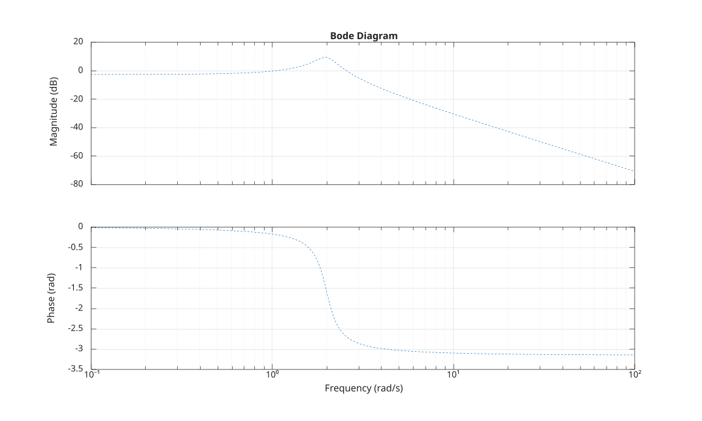

# bodeplot

Bode plot of a SISO LTI system with plotting options.

## 📝 Syntax

- bodeplot(sys)
- bodeplot(sys, opt)
- bodeplot(sys, lineSpec)
- bodeplot(sys, opt, lineSpec)
- bodeplot(sys, w, ...)
- [magnitude, phase, w] = bodeplot(...)

## 📥 Input argument

- sys - a SISO LTI model.
- opt - an options structure returned by bodeoptions.
- lineSpec - Line style, marker, and color.
- w - a cell {wmin, wmax} or a frequency vector.

## 📤 Output argument

- magnitude - Magnitude: size 1 x 1 x k (SISO).
- phase - Phase: size 1 x 1 x k (SISO).
- w - Frequencies: a vector: 1 x k.

## 📄 Description


<b>bodeplot(sys)</b> generates a Bode plot of the SISO LTI system <b>sys</b>, like <b>bode</b>. 

<b>bodeplot(sys, opt)</b> applies the plotting options described by <b>opt</b> (see <b>bodeoptions</b>). 

When <b>opt.PhaseUnits</b> is <b>'rad'</b>, the phase is plotted in radians. When <b>opt.Grid</b> is <b>'on'</b>, a grid is displayed. 

A <b>lineSpec</b> character vector and a frequency specification <b>w</b> can also be provided, as with <b>bode</b>.

## 💡 Example


```matlab
G = tf([3], [1 1/2 4]);
opt = bodeoptions();
opt.PhaseUnits = 'rad';
opt.Grid = 'on';
f = figure();
bodeplot(G, opt, '--');

```



## 🔗 See also

[bode](../../control_system/3_linear_analysis/bode.md), [bodeoptions](../../control_system/3_linear_analysis/bodeoptions.md).

## 🕔 History

| Version | 📄 Description     |
| ------- | --------------- |
| 1.0.0   | initial version |

<!--
## 👤 Author

Allan CORNET
-->
