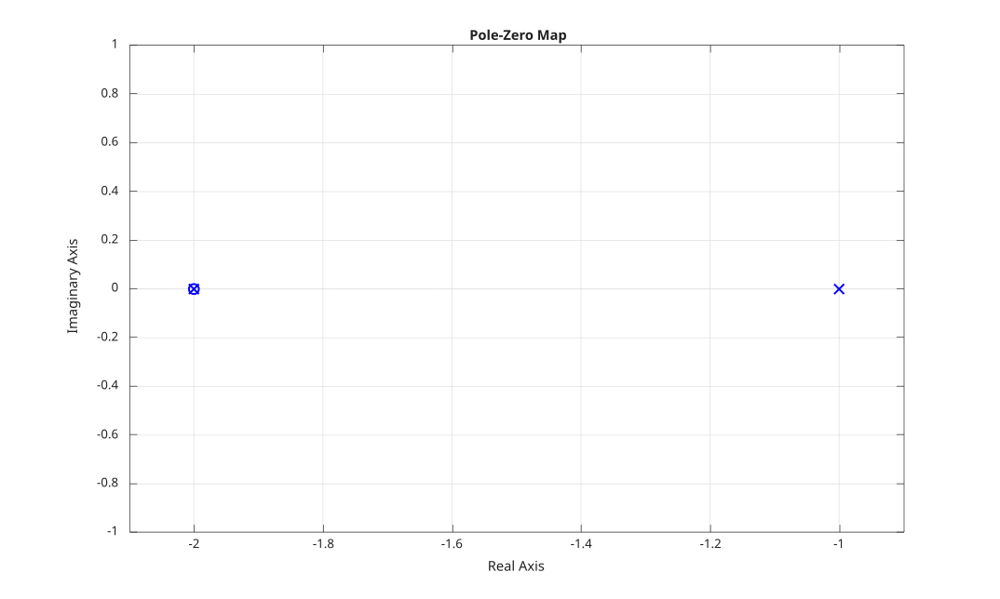

# pzmap

Pole-zero map of a dynamic system.

## 📝 Syntax

- pzmap(sys)
- [p, z] = pzmap(sys)

## 📥 Input argument

- sys - Dynamic system: a SISO LTI model.

## 📤 Output argument

- p - Poles of the system.
- z - Zeros of the system.

## 📄 Description


<b>pzmap(sys)</b> plots the poles and zeros of the dynamic system model <b>sys</b> in the complex plane. 

Each pole is marked with an <b>x</b> and each zero with an <b>o</b>. 

When output arguments are requested, <b>[p, z] = pzmap(sys)</b> returns the poles <b>p</b> and the zeros <b>z</b> without producing a plot.

## 💡 Examples


```matlab
f = figure();
sys = tf([1 2], [1 3 2]);
pzmap(sys);

```



```matlab
sys = tf([1 2], [1 3 2]);
[p, z] = pzmap(sys)

```


## 🔗 See also

[pole](../../control_system/1_dynamic_system_models/pole.md), [zero](../../control_system/1_dynamic_system_models/zero.md), [bode](../../control_system/3_linear_analysis/bode.md).

## 🕔 History

| Version | 📄 Description     |
| ------- | --------------- |
| 1.0.0   | initial version |

<!--
## 👤 Author

Allan CORNET
-->
