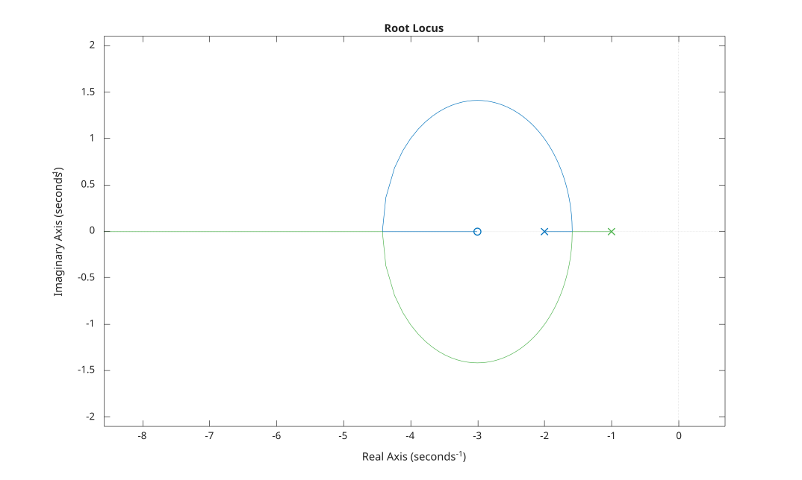

# rlocus

Root locus of a SISO model.

## 📝 Syntax

- rlocus(sys)
- rlocus(sys, k)
- rlocus(sys1, sys2, ...)
- [r, k] = rlocus(sys)
- [r, k] = rlocus(sys, k)

## 📥 Input argument

- sys - SISO dynamic system
- k - Vector of feedback gains

## 📤 Output argument

- r - Complex closed-loop pole locations, one column per gain
- k - Vector of gains used

## 📄 Description


The root locus function, <b>rlocus(sys)</b>, computes and plots the locus of the closed-loop poles of the feedback loop <b>feedback(k\*sys, 1)</b>, that is the roots of <b>den + k\*num</b>, as the gain <b>k</b> sweeps from 0 to infinity. 

Each branch starts at an open-loop pole (marked <b>x</b>) for <b>k = 0</b> and ends at a finite open-loop zero (marked <b>o</b>) or goes to infinity as <b>k</b> grows. 

When a gain vector <b>k</b> is supplied, those gains are used instead of the automatically selected range. 

With output arguments, <b>[r, k] = rlocus(sys)</b> returns the closed-loop pole locations and the gains without plotting.

## 💡 Examples


```matlab
f = figure();
sys = tf([1 3], [1 3 2]);
rlocus(sys);

```



```matlab
G = tf(1, [1 3 2]);
[r, k] = rlocus(G);

```


## 🔗 See also

[nyquist](../../control_system/3_linear_analysis/nyquist.md), [bode](../../control_system/3_linear_analysis/bode.md).

## 🕔 History

| Version | 📄 Description     |
| ------- | --------------- |
| 1.0.0   | initial version |

<!--
## 👤 Author

Allan CORNET
-->
