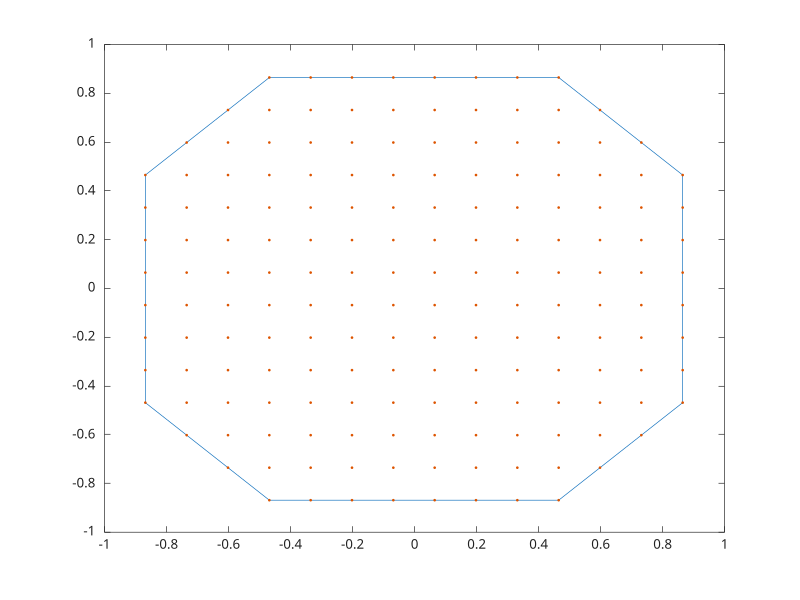

# alphaShape

Alpha shape object

## 📝 Syntax

- SHP = alphaShape(P)
- SHP = alphaShape(x, y)
- SHP = alphaShape(x, y, z)
- SHP = alphaShape(..., alpha)
- SHP = alphaShape(..., 'HoleThreshold', value, 'RegionThreshold', value)
- K = boundaryFacets(SHP)
- A = area(SHP)
- plot(SHP)

## 📄 Description


<b>alphaShape</b> stores points and alpha parameters for boundary and shape queries.

## 💡 Example

Create and plot an alpha shape.

```matlab
[x, y] = meshgrid(linspace(-1, 1, 16));
P = [x(:), y(:)];
P(hypot(P(:, 1), P(:, 2)) > 1, :) = [];
SHP = alphaShape(P, 0.3);
A = area(SHP);
plot(SHP)
hold('on')
plot(P(:, 1), P(:, 2), '.')
```



## 🔗 See also

[boundary](../geometry/boundary.md), [convhull](../geometry/convhull.md).

## 🕔 History

| Version | 📄 Description     |
| ------- | --------------- |
| 2.0.0   | Initial version. |

<!--
## 👤 Author

Allan CORNET
-->
