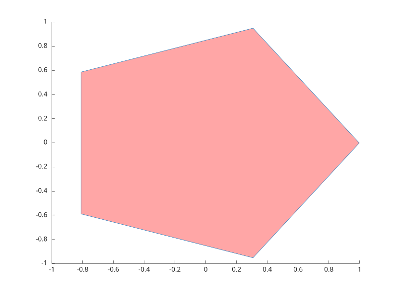

# polyshape

Create a polygon.

## 📝 Syntax

- pg = polyshape(x, y)
- pg = polyshape(P)

## 📥 Input argument

- x, y - vectors of the polygon vertex coordinates.
- P - an N-by-2 matrix of vertices [x y].

## 📤 Output argument

- pg - a polyshape object.

## 📄 Description


<b>polyshape</b> creates a polygon from its vertices. The methods <b>area</b>, <b>perimeter</b> and <b>numsides</b> query it, <b>rotate</b>and <b>translate</b> transform it, and <b>plot</b> draws it as a filled patch (accepting patch name-value properties). <b>rotate(pg, theta)</b>turns the polygon counterclockwise by <b>theta</b> degrees about the origin, or about a reference point given as a third argument; <b>translate(pg, [dx dy])</b> shifts it.

## 💡 Example


```matlab
f = figure();
t = linspace(0, 2*pi, 6);
t(end) = [];
pg = polyshape(cos(t), sin(t));
plot(pg, 'FaceColor', 'r');
area(pg)
```



## 🔗 See also

[nsidedpoly](../geometry/nsidedpoly.md), [polyarea](../geometry/polyarea.md).

## 🕔 History

| Version | 📄 Description     |
| ------- | --------------- |
| 2.0.0   | Initial version. |

<!--
## 👤 Author

Allan CORNET
-->
