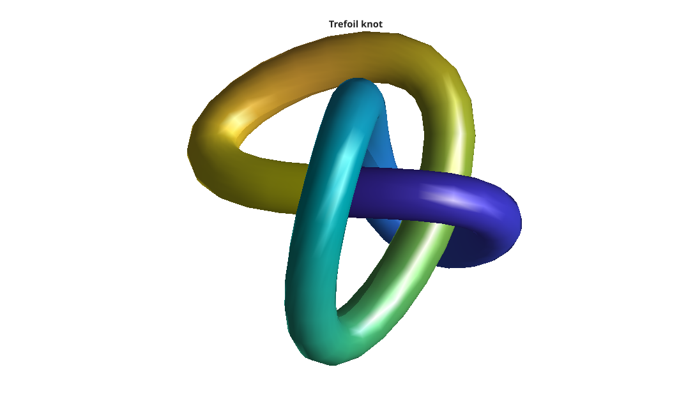

# knot

Create a trefoil knot surface.

## 📝 Syntax

- [X, Y, Z] = knot()
- [X, Y, Z] = knot(n)
- knot()
- knot(n)
- knot(ax, n)

## 📥 Input argument

- n - Number of facets around the tube cross-section: positive whole number (default 16).
- ax - Target axes: 'axes' object.

## 📤 Output argument

- X, Y, Z - x-, y-, and z- coordinates of the knot surface without drawing it.

## 📄 Description


<b>knot</b> builds and plots a smooth tube swept around a trefoil knot curve (the classic (2,3) torus knot). 

The curve is analytic, so the tube is generated by sweeping a circular cross-section along the Frenet frame (tangent, principal normal and binormal) of the curve.

## 💡 Example


```matlab
f = figure();
knot();
axis equal
title('Trefoil knot');
```



## 🔗 See also

[sphere](../../../graphics/1_plots/7_surfaces_volumes_polygons/sphere.md), [cylinder](../../../graphics/1_plots/7_surfaces_volumes_polygons/cylinder.md), [surf](../../../graphics/1_plots/7_surfaces_volumes_polygons/surf.md).

## 🕔 History

| Version | 📄 Description     |
| ------- | --------------- |
| 1.0.0   | initial version |

<!--
## 👤 Author

Allan CORNET
-->
