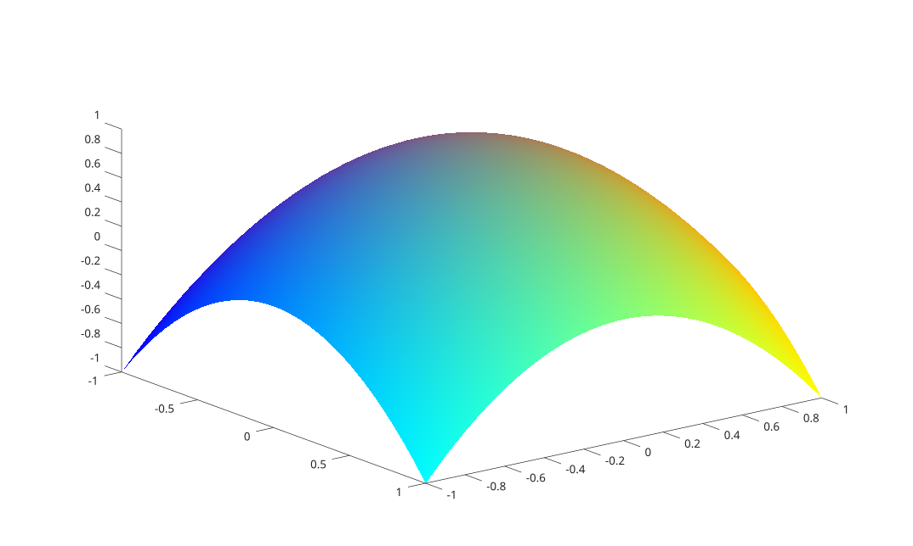

# warp

Display an image as a texture mapped onto a surface.

## 📝 Syntax

- warp(X, Y, Z, A)
- warp(Z, A)
- warp(Z, A, map)
- warp(X, Y, Z, A, map)
- h = warp(...)

## 📥 Input argument

- X, Y, Z - Surface coordinates. X and Y may be vectors or matrices; Z is a matrix. When omitted (warp(Z, A) forms), X and Y are built from the size of Z.
- A - Image mapped onto the surface: an indexed (M-by-N) image or a truecolor (M-by-N-by-3) image. Its size is independent of the surface grid.
- map - Colormap (P-by-3) used when A is an indexed image. It is applied to the current axes.

## 📤 Output argument

- h - Handle of the created surface object.

## 📄 Description


Display the image <b>A</b> texture mapped onto the surface defined by <b>X</b>, <b>Y</b> and <b>Z</b>. 

The image is mapped per fragment, so it stays crisp regardless of how coarse the surface grid is; its resolution is independent of the number of surface points. 

The created surface uses <b>FaceColor</b> set to <b>texturemap</b>, <b>EdgeColor</b> set to <b>none</b> and <b>CDataMapping</b> set to <b>direct</b>. The axes are displayed with a reversed Y direction and a default 3-D view. 

This is equivalent to creating a surface and setting its <b>FaceColor</b> property to <b>texturemap</b> with the image as <b>CData</b>.

## 💡 Example

Warp a color gradient onto a dome

```matlab
n = 64;
[tx, ty] = meshgrid(linspace(0, 1, n), linspace(0, 1, n));
A = zeros(n, n, 3);
A(:, :, 1) = tx;
A(:, :, 2) = ty;
A(:, :, 3) = 1 - tx;
[X, Y] = meshgrid(linspace(-1, 1, 30), linspace(-1, 1, 30));
Z = 1 - (X .^ 2 + Y .^ 2);
figure;
warp(X, Y, Z, A);
```



## 🔗 See also

[surface](../../../graphics/1_plots/7_surfaces_volumes_polygons/surface.md), [surf](../../../graphics/1_plots/7_surfaces_volumes_polygons/surf.md), [imwarp](../../../image_processing/3_geometry_registration_3d/6_geometric_transforms/imwarp.md).

## 🕔 History

| Version | 📄 Description     |
| ------- | --------------- |
| 2.0.0   | initial version |

<!--
## 👤 Author

Allan CORNET
-->
