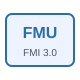

# fmu

Runs a co-simulation FMU inside an NFlow diagram.

## 📝 Syntax

- Block type: fmu

## 📄 Description

The WebAssembly browser version supports FMI 3.0 Co-Simulation components packaged under binaries/wasm32-wasip2, including numeric and Boolean vector ports. Use Browse FMU to upload an archive. The bundled reference demos include both native and Wasm binaries. 

The <b>FMU (CS)</b> block loads the archive selected by <b>path</b> and advances its co-simulation instance with the NFlow simulation. 

After import, the block ports and parameters follow the variables exposed by the FMU model description. 

## 🔗 See also

[fmuToBlock](../../nflow_fmi/fmuToBlock.md).