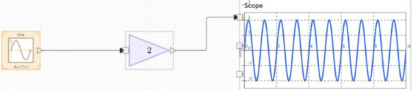

# nflow\_tutorial\_first\_model

Tutorial 1 of 3: build, wire, and run a first nflow model.

## 📝 Syntax

- Tutorial: place three blocks, connect them, run, and read the scope.

## 📄 Description

This is the first of three short tutorials. You build a model with three blocks, a Sine source, a Gain, and a Scope, then run it and read the result. The model has no feedback and no dynamics, so it is a good way to learn the editor itself: placing blocks, drawing wires, editing parameters, and running a simulation. 

<b>Open the editor</b> 

Call <b>nflow()</b> from the Nelson command line to open an empty model. The block library is on the left, the diagram canvas is in the center, and the inspector is on the right. Select a block to see its parameters in the inspector, or select nothing to see the Model tab with the simulation settings. 

<b>Place the blocks</b> 
2. In the library, open the <b>Source</b> group and drag a <b>Sine</b> block onto the canvas. 
4. Open the <b>Math</b> group and drag a <b>Gain</b> block to the right of the Sine block. 
6. Open the <b>Sinks</b> group and drag a <b>Scope</b> block to the right of the Gain block.
 

Leave room between the blocks so the wires have space to route. 

<b>Connect the blocks</b> 
2. Move the pointer over the output port on the right of the Sine block, then drag to the input port on the left of the Gain block. Release to create the wire. 
4. Draw a second wire the same way, from the Gain output to the Scope input.
 

When <b>autoRoute</b> is on, the editor keeps the wires orthogonal and clear as you move blocks. See <b>nflow\_wire\_editing</b> for manual routing, corners, and junctions. 

<b>Set the block parameters</b> 

Select the <b>Gain</b> block and set <b>Gain</b> to 2 in the inspector. Select the <b>Sine</b> block to set its amplitude and frequency, or keep the defaults. Each change is applied to the block as you type. 

<b>Set the run duration</b> 

Select nothing to show the <b>Model</b> tab, then open <b>Simulation</b>. Set <b>Runtime (s)</b> to the length of the run, for example 10. Leave <b>Sample Time (s)</b> at its default for this model. 

<b>Run the model</b> 

Press <b>Run</b> in the toolbar above the diagram, or use the <b>Simulation</b> menu. The Scope fills while the model runs. <b>Stop</b> ends the run and keeps the results already computed. <b>Reset</b> returns time to zero and clears the displayed results. 

<b>Read the scope</b> 

The Scope shows the amplified sine wave. Select the Scope and use the inspector to set the time and value ranges (<b>t min</b>, <b>t max</b>, <b>y min</b>, <b>y max</b>), to show tick labels, and to set the trace color and axis labels. Leave a range field empty to let the Scope fit the data. 

 

<b>What to try next</b> 

Replace the Sine with a <b>Step</b> or a <b>Pulse</b> from the Source group to see how the output follows a different input. Then continue with <b>nflow\_tutorial\_continuous</b> to add an integrator and choose a solver.

## 🔗 See also

[nflow](../nflow_gui/nflow.md), [nflow_workspace](../nflow_gui/nflow_workspace.md), [nflow_wire_editing](../nflow_gui/nflow_wire_editing.md), [nflow_tutorial_continuous](../nflow_gui/2_nflow_tutorial_continuous.md), [nflow_tutorial_dashboard](../nflow_gui/3_nflow_tutorial_dashboard.md).

## 🕔 History

| Version | 📄 Description     |
| ------- | --------------- |
| 1.0.0   | initial version |

<!--
## 👤 Author

Allan CORNET
-->
