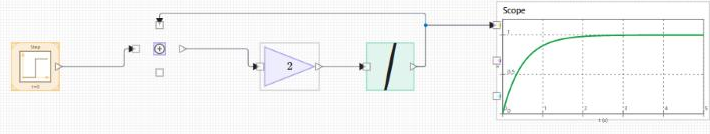
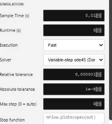

# nflow\_tutorial\_continuous

Tutorial 2 of 3: simulate a continuous system and choose a solver.

## 📝 Syntax

- Tutorial: build a first-order system with feedback, then select a solver.

## 📄 Description


This second tutorial builds a continuous system and shows how the solver changes the way it is integrated. The model is a first-order lag: a step input drives a state that approaches the input with time constant tau. The equation is dx/dt = (u - x) / tau, which you build with a Sum, a Gain, and an Integrator wired in a feedback loop. It assumes you have done <b>nflow\_tutorial\_first\_model</b>. 

<b>Place the blocks</b> 
2. From the <b>Source</b> group, drag a <b>Step</b> block onto the canvas. 
4. From the <b>Math</b> group, drag a <b>Sum</b> block and a <b>Gain</b> block. 
6. From the <b>Continuous</b> group, drag an <b>Integrator</b> block. 
8. From the <b>Sinks</b> group, drag a <b>Scope</b> block.
 

<b>Set the block parameters</b> 

Select the <b>Sum</b> block and set its signs to one plus and one minus, so it computes the input minus the fed-back state. Select the <b>Gain</b> block and set <b>Gain</b> to 1 / tau; for tau = 0.5 s, set it to 2. Leave the <b>Integrator</b> at an initial condition of 0. 

<b>Connect the blocks</b> 
2. Wire the <b>Step</b> output to the plus input of the <b>Sum</b>. 
4. Wire the <b>Sum</b> output to the <b>Gain</b>, and the <b>Gain</b> output to the <b>Integrator</b>. 
6. Wire the <b>Integrator</b> output to the <b>Scope</b>, and also back to the minus input of the <b>Sum</b> to close the loop.
 

The wire from the Integrator back to the Sum is the feedback path. It is what makes the state settle instead of growing without bound. 



 

<b>Run with the default engine</b> 

Set <b>Runtime (s)</b> to about 5 in the Model tab and press <b>Run</b>. With no solver selected, nflow uses the fixed-step discrete engine, and each continuous block integrates with a per-block Euler step at the model <b>Sample Time (s)</b>. The Scope shows the state rising toward the step value along an exponential curve. 

<b>Choose a solver</b> 

Open the Model tab and set the <b>Solver</b>. The default (discrete) keeps the fixed-step engine. Select <b>ode4</b> for a fixed-step fourth-order Runge-Kutta integration, which is more accurate than Euler at the same step. Select <b>ode45</b> for an adaptive step controlled by the tolerances. When an adaptive solver is selected, set <b>Relative tolerance</b> and <b>Absolute tolerance</b>, and an optional <b>Max step (0 = auto)</b> ceiling. Tighter tolerances give a more accurate trajectory at the cost of more sub-steps. See <b>nflow\_solvers</b> for the full list and for how each solver maps to generated C and Rust code. 



 

<b>Compare the step size</b> 

Lower the <b>Sample Time (s)</b> and run again with the discrete engine to see the Euler result approach the ode4 result. This is the trade-off a solver manages for you: accuracy against the number of steps. 

<b>What to try next</b> 

Add a second Integrator and a feedback gain to make a second-order system such as a mass-spring-damper, then continue with <b>nflow\_tutorial\_dashboard</b> to drive the model with live controls while it runs.

## 💡 Example

Open a continuous model and try different solvers on it.

```matlab
open_system([modulepath('nflow_blocks', 'root'), '/examples/causal/Second_Order_Responses_Demo.nflow']);
```


## 🔗 See also

[nflow_solvers](../nflow_gui/nflow_solvers.md), [nflow_multirate](../nflow_gui/nflow_multirate.md), [nflow_tutorial_first_model](../nflow_gui/1_nflow_tutorial_first_model.md), [nflow_tutorial_dashboard](../nflow_gui/3_nflow_tutorial_dashboard.md).

## 🕔 History

| Version | 📄 Description     |
| ------- | --------------- |
| 1.0.0   | initial version |

<!--
## 👤 Author

Allan CORNET
-->
