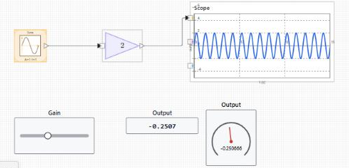
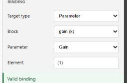

# nflow\_tutorial\_dashboard

Tutorial 3 of 3: add interactive dashboard controls and run in real time.

## 📝 Syntax

- Tutorial: bind a slider, a display, and a gauge, then run and adjust live.

## 📄 Description


This third tutorial adds interactive controls to a running model. You place a Slider, a Display, and a Gauge, bind them to the model, and run in real time so you can change a parameter and watch the response. It continues from the model built in <b>nflow\_tutorial\_continuous</b>, but any model with an adjustable parameter and an output signal works. 

<b>Place the dashboard blocks</b> 
2. From the <b>Dashboard</b> group, drag a <b>Slider</b> onto the canvas. 
4. Drag a <b>Display</b> next to it. 
6. Drag a <b>Gauge</b> next to the Display.
 

Dashboard blocks have no input or output ports. Each one reads or writes a target that you choose in the inspector, so they are placed anywhere on the canvas without wires. 



 

<b>Bind the controls</b> 
2. Select the <b>Slider</b>. In the inspector <b>Binding</b> section, set the kind to <b>Parameter</b>, then pick a block and one of its adjustable parameters, for example the Gain of the model. Set the slider limits. 
4. Select the <b>Display</b>. Set the binding kind to <b>Signal</b>, then pick a block output and its one-based port. 
6. Select the <b>Gauge</b>. Bind it to a signal the same way and set its limits.
 

The status under the binding selector reports whether the binding is valid or why it is not. Bindings use stable block identifiers, so renaming or moving a block does not break them. See <b>nflow\_dashboard</b> for every control and display and for the signal, parameter, and variable targets. 



 

<b>Set the execution mode</b> 

Select nothing to show the Model tab, then open <b>Simulation</b> and set <b>Execution</b>. <b>Real-time</b> paces the run to the wall clock, so one second of simulated time takes about one second, which is what you want when adjusting controls by hand. <b>Fast</b> runs as quickly as the machine allows. <b>Auto</b> lets the model decide. 

The execution mode is read when a run starts. Set it before you press <b>Run</b>. Changing it while a simulation is running does not affect that run; it applies to the next one. This is different from a dashboard control bound to a parameter, whose change is applied during the run at the next step. 

<b>Run and interact</b> 

Press <b>Run</b>. While the model runs, drag the Slider to change its bound parameter. The Display and the Gauge update at each major step, and the Scope shows how the response changes. A pointer gesture that starts on a control stays with that control until you release it, so you can drag a slider without moving the block. To move the block instead, drag its body outside the control area. 

<b>What to try next</b> 

Add a <b>Lamp</b> or a <b>Gauge</b> with colored ranges to flag a threshold, or a <b>Push Button</b> to switch a parameter between two states. Open the runnable examples below to see a full interactive panel.

## 💡 Examples

Open a model with live signal displays and a bound Slider.

```matlab
open_system([modulepath('nflow_blocks', 'root'), '/examples/dashboard/Dashboard_Runtime_Demo.nflow']);
```
Open the gallery containing all dashboard blocks.

```matlab
open_system([modulepath('nflow_blocks', 'root'), '/examples/dashboard/Dashboard_Gallery_Demo.nflow']);
```


## 🔗 See also

[nflow_dashboard](../nflow_gui/nflow_dashboard.md), [nflow_workspace](../nflow_gui/nflow_workspace.md), [nflow_tutorial_first_model](../nflow_gui/1_nflow_tutorial_first_model.md), [nflow_tutorial_continuous](../nflow_gui/2_nflow_tutorial_continuous.md).

## 🕔 History

| Version | 📄 Description     |
| ------- | --------------- |
| 1.0.0   | initial version |

<!--
## 👤 Author

Allan CORNET
-->
