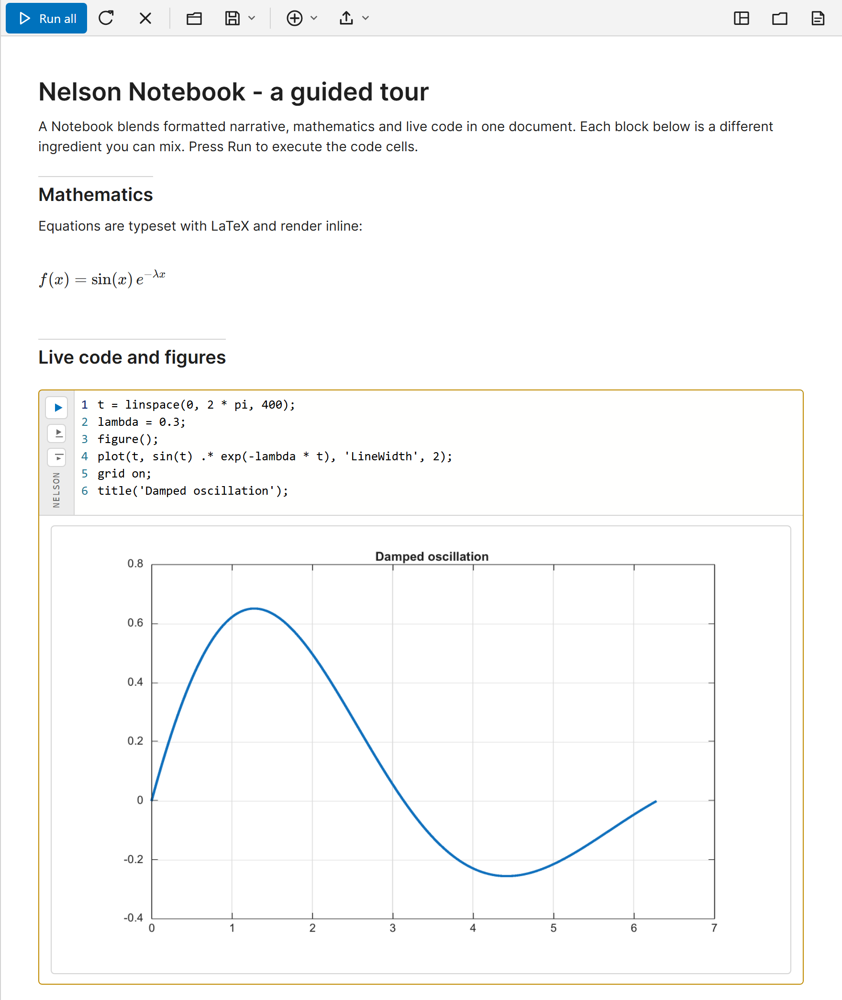

# Your first Nelson Notebook

Create, run and save your first Notebook document.

## 📄 Description

A <b>Notebook</b> is a single document that holds formatted text, Nelson code and the output of that code, in the order you arrange them. It is built from <b>blocks</b>: a heading, a paragraph, a code cell, an equation or an interactive control. Running a code cell shows its text output and its figures just below the code, so the explanation, the computation and the result stay together. 

All the code cells of one document share a single workspace, the same base workspace used at the command line. A variable created in one cell is visible to the cells that run after it. This tutorial creates a document, runs it and saves it. 

<b>Open the editor</b> 

The <b>notebook</b> function opens the Notebook editor: 

- <b>notebook()</b> with no argument opens a new, empty document. 
- <b>notebook(filename, 'edit')</b> opens an existing document, and <b>edit(filename)</b> does the same for a <b>.nlx</b> file. 

On the Nelson desktop you can also use the <b>New Notebook</b> button of the toolbar, or the <b>Window</b> menu. The editor opens as a tab of the web desktop, or, on the Qt desktop, as the Notebook window (one window, one tab per document). Without a desktop (nelson-cli, nelson-adv-cli) the editor cannot open and the call reports an error. 

The editor shows a toolbar at the top and the document below. A new document already contains a short example you can run and edit. 

 

<b>Add text and code</b> 

Click in the document and type to write text. Press <b>Enter</b> to start a new block. To insert anything other than a paragraph, type <b>/</b> at the start of a line and pick an item from the list, or use the <b>Insert</b> menu of the toolbar. Choose <b>Code cell</b> to add a cell and type Nelson code in it, for example: 

<code>x = linspace(0, 2 * pi, 200);</code> 

<code>plot(x, sin(x))</code> 

<b>Run a cell</b> 

Each code cell has a run button in its left margin. Click it to run that one cell, or click <b>Run all</b> in the toolbar to run every code cell from top to bottom. The text output appears under the cell, and any figure the cell draws is shown inline, in the document, instead of a separate figure window. 

<b>The shared workspace</b> 

Because the cells share one workspace, you can split a computation across several cells. The value set in an earlier cell is used by a later one: 
2. First cell: <code>N = 200;</code> 
4. Second cell: <code>x = linspace(0, 2 * pi, N);</code> 
6. Third cell: <code>plot(x, sin(x))</code>
 

What matters is the order in which the cells run, not their position on the page. If a later cell reports an unknown variable, run the earlier cells first, or use <b>Run all</b>. 

<b>Save your work</b> 

Use <b>Save</b> in the toolbar to write the document as a <b>.nlx</b> file, the native Notebook format. The <b>.nlx</b> container keeps the text, the code, the saved output and the figures together in one portable file. You can also save the document as a plain-text <b>.m</b> script with <b>Save as Script</b>. Reopen a saved document with <b>Open</b>, with <b>edit(filename)</b> or with <b>notebook(filename, 'edit')</b>. 

<b>What next</b> 

The next tutorials describe the block kinds and the interactive controls, and how to run or share a document without the editor.

## 🔗 See also

[Notebook cells and controls](../notebook/2_notebook_cells_and_controls.md), [Run and share a Notebook](../notebook/3_notebook_run_and_share.md), [notebook](../notebook/notebook.md), [nlx](../notebook/nlx.md).

## 🕔 History

| Version | 📄 Description     |
| ------- | --------------- |
| 2.0.0   | initial version |

<!--
## 👤 Author

Allan CORNET
-->
