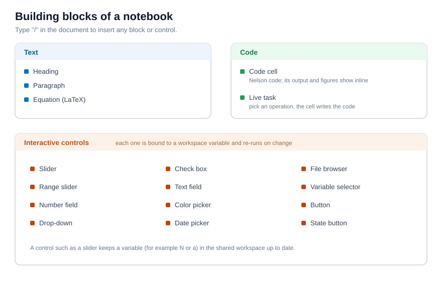

# Notebook cells and controls

The block kinds of a Notebook and the interactive controls.

## 📄 Description

A Notebook is a sequence of <b>blocks</b>. Some blocks are narrative, one runs code, and others are interactive controls that drive a variable. You insert any of them by typing <b>/</b> in the document, or from the <b>Insert</b> menu of the toolbar. 

 

<b>Text blocks</b> 

A <b>heading</b> and a <b>paragraph</b> hold formatted text: titles, bold and italic words, and lists. They carry the explanation around the code and never run. 

<b>Equations</b> 

An <b>equation</b> block holds a LaTeX formula and renders it inline, next to your text. For example <code>f(x) = \sin(x)\,e^{-\lambda x}</code> is typeset as a mathematical expression. Equations are for display only; they are not evaluated. 

<b>Code cells</b> 

A <b>code cell</b> holds Nelson code. Its left margin has three run buttons: run this cell, run up to this cell, and run the section (a code cell together with the text and controls above it, up to the previous heading). The toolbar adds <b>Run all</b> for the whole document. 

When you change a cell, the cells whose result may now be out of date are marked. <b>Run stale</b> re-runs only those and the cells that depend on them, instead of the whole document. <b>Clear</b> removes every saved output. 

<b>Live task</b> 

A <b>live task</b> is a point-and-click cell: you choose an operation and its inputs, and the cell writes the Nelson code for you and runs it. It is a quick way to build a step without writing the code by hand. 

<b>Interactive controls</b> 

A control is bound to a workspace variable. When you move or change the control, it sets that variable and re-runs the cells that use it, so a figure updates while you adjust a value. The available controls are: 

- <b>Slider</b> and <b>range slider</b> - a number, or a low and high pair, from a continuous range. 
- <b>Number field</b> - a single number typed or stepped. 
- <b>Drop-down</b> - one value chosen from a list. 
- <b>Check box</b> and <b>state button</b> - a logical on or off. 
- <b>Text field</b> - a short text or number. 
- <b>Color picker</b> - a colour, as an RGB triplet. 
- <b>Date picker</b> - a date, as text. 
- <b>File browser</b> - a file path. 
- <b>Variable selector</b> - an existing workspace variable, passed on under a new name. 
- <b>Button</b> - runs the cells on demand, without binding a variable. 

For example, a slider labelled <b>Frequency</b> bound to the variable <code>frequency</code> sets that variable each time you move it, and a cell that plots <code>sin(frequency * x)</code> redraws at once. 

<b>A shareable view</b> 

<b>Hide code</b> folds the code cells away and keeps the text, the controls and the output, which turns the document into a short report a reader can use without seeing the code. <b>Outline</b> lists the headings so you can move through a long document.

## 🔗 See also

[Your first Nelson Notebook](../notebook/1_notebook_first_steps.md), [Run and share a Notebook](../notebook/3_notebook_run_and_share.md), [nlx](../notebook/nlx.md).

## 🕔 History

| Version | 📄 Description     |
| ------- | --------------- |
| 2.0.0   | initial version |

<!--
## 👤 Author

Allan CORNET
-->
