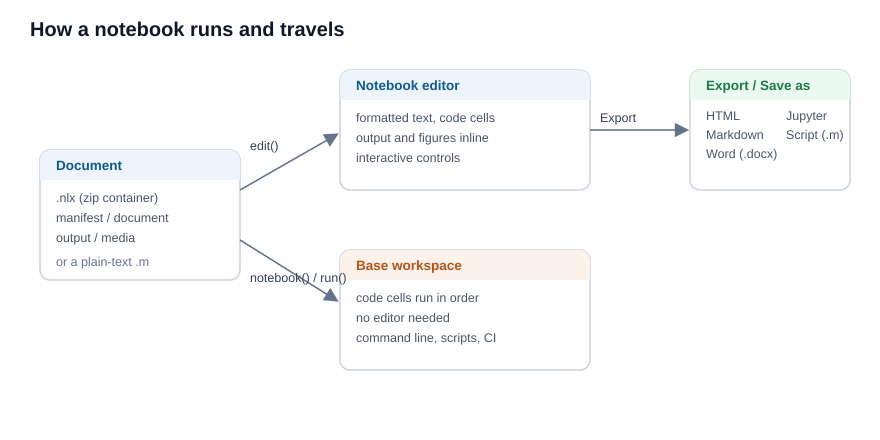

# Run and share a Notebook

Run a Notebook without the editor, and export or import it.

## 📄 Description


A Notebook document is more than an editor view. The same file runs from the command line, saves and travels as one portable file, and converts to and from other formats. 



 

<b>Run without the editor</b> 

<b>notebook(filename)</b> runs a document without opening it: it reads the code of each code cell, in order, and evaluates it against the base workspace, exactly as the editor would. <b>run(filename)</b> on a <b>.nlx</b> file does the same. This is how a document runs from nelson-cli or in a batch job, where no editor is available. The text blocks, headings, equations and controls are skipped; only the code cells run. 

<b>The .nlx container</b> 

The native <b>.nlx</b> file is a zip container. It keeps the source (<b>document.json</b>), the saved output (<b>output.json</b>) and the figures (<b>media/</b>) apart, so the source stays small and reads cleanly, while the saved figures travel with it. The <b>nlx</b> reference page describes every entry. 

<b>The plain-text .m form</b> 

A Notebook can also be saved as a plain-text <b>.m</b> script, where each block is written under a <code>%% [kind]</code> marker (for example <code>%% [code]</code> or <code>%% [text]</code>). This file opens in any text editor and runs as an ordinary script. An <b>.m</b> file with no such marker is treated as one single code cell and run whole. 

<b>Export and import</b> 

From the <b>Export</b> menu a document is written as <b>HTML</b>, <b>Markdown</b>, <b>Word (.docx)</b> or a <b>Jupyter notebook (.ipynb)</b>, and <b>Save as Script</b> writes the plain-text <b>.m</b> form. <b>Open</b> reads a <b>.nlx</b> document, a plain <b>.m</b> script or a <b>.ipynb</b> notebook back into the editor. 

<b>Check that a document runs top to bottom</b> 

A document is reliable when it runs from an empty workspace, in order, with no error. Because the cells share the base workspace, a variable left over from an earlier session can hide a missing step. To check, run the document in a fresh session, for example with <code>nelson-cli</code> and <b>notebook(filename)</b>; if a cell fails, the run stops with the error. This same check fits a continuous-integration job. 

The example below builds a minimal <b>.nlx</b> document and runs it without the editor.

## 💡 Example

Build a Notebook (.nlx) document and run it headless.

```matlab
% write the source of a one-cell document
d = [tempdir(), createGUID()];
mkdir(d);
fw = fopen([d, '/document.json'], 'wt');
fwrite(fw, '{"blocks":[{"type":"codecell","props":{"code":"answer = 6 * 7;"}}]}');
fclose(fw);
fw = fopen([d, '/manifest.json'], 'wt');
fwrite(fw, '{"format":"nelson-notebook","version":1}');
fclose(fw);
% pack it as a .nlx container
nlx = [tempdir(), createGUID(), '.nlx'];
odir = pwd();
cd(d);
zip(nlx, '*.json');
cd(odir);
% run it: the code cell evaluates against the base workspace
notebook(nlx);
answer
```


## 🔗 See also

[Your first Nelson Notebook](../notebook/1_notebook_first_steps.md), [Notebook cells and controls](../notebook/2_notebook_cells_and_controls.md), [notebook](../notebook/notebook.md), [nlx](../notebook/nlx.md), [run](../core/run.md).

## 🕔 History

| Version | 📄 Description     |
| ------- | --------------- |
| 2.0.0   | initial version |

<!--
## 👤 Author

Allan CORNET
-->
