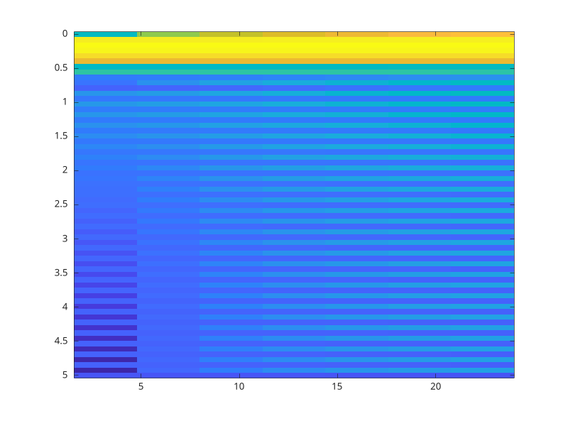

# spectrogram

Spectrogram using short-time Fourier transforms.

## 📝 Syntax

- [S, F, T] = spectrogram(X)
- [S, F, T, P] = spectrogram(X, window, noverlap, NFFT, Fs)

## 📥 Input argument

- X - input signal.
- window - window vector or length.
- noverlap - number of overlapping samples.
- NFFT - FFT length.
- Fs - sample rate.

## 📤 Output argument

- S - complex short-time spectrum.
- F - frequency vector.
- T - time vector.
- P - power spectral density estimate.

## 📄 Description


<b>spectrogram</b> splits the signal into overlapping windowed segments and computes an FFT for each segment.

## 💡 Examples


```matlab

[s, f, t] = spectrogram(sin((0:255)' * 0.1), 64, 32, 128, 10);

```
Display the short-time Fourier transform spectrogram.

```matlab
spectrogram(sin((0:255)' * 0.1), 64, 32, 128, 10);
```



## 🔗 See also

[stft](../../signal_processing/6_time_frequency_analysis/stft.md), [periodogram](../../signal_processing/5_spectral_analysis/periodogram.md).

## 🕔 History

| Version | 📄 Description     |
| ------- | --------------- |
| 2.0.0   | initial version |

<!--
## 👤 Author

Allan CORNET
-->
