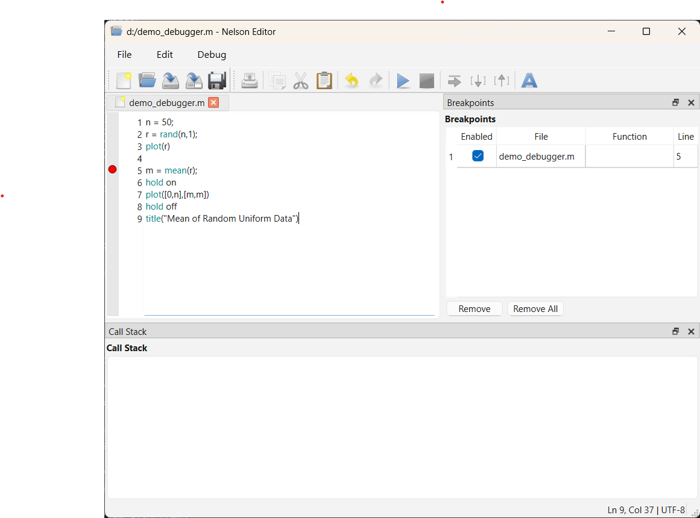
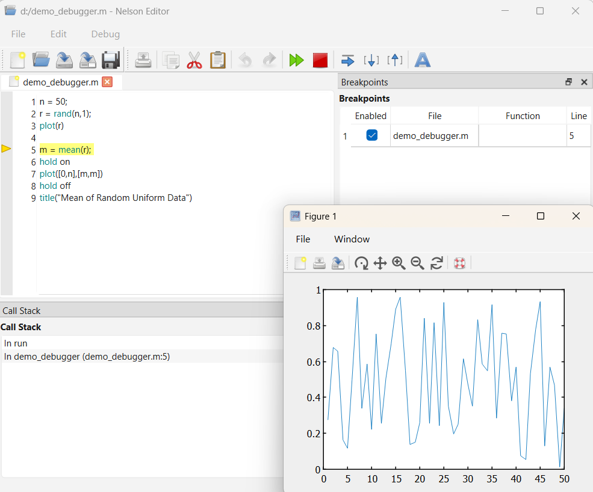

# debugging workflow

Debugging workflow for Nelson code files in the editor.

## 📄 Description


The Nelson debugger provides interactive tools to diagnose and fix problems in scripts and functions by controlling execution and inspecting program state. The Qt desktop and the web desktop expose the same controls, keys, marker colours and menu labels. 

Before starting a debugging session, save the code files. Breakpoints belong to the saved file: while a file has unsaved changes its markers turn dark gray (invalid) and are re-applied to their new lines when the file is saved. Saving a file while execution is paused ends the debugging session. 

<b>Breakpoints</b> 

Click in the left margin next to a line number, or press <b>F12</b> on the line, to set or clear a standard breakpoint (red). A breakpoint requested on a comment, a blank line or a <code>function</code> line moves to the next executable line; the <code>end</code> of a loop or of a function is a stop line of its own. Lines such as <code>else</code>, <code>elseif</code>, <code>case</code>, <code>otherwise</code> and <code>catch</code> move to the next statement. 

Right-click the margin to open the breakpoint menu: <b>Set/Clear Breakpoint</b>, <b>Set/Modify Condition...</b> (orange conditional breakpoint: execution pauses only when the expression is true; an expression that fails or is not a scalar prints a warning and pauses), <b>Enable/Disable Breakpoint</b> (light gray when disabled), <b>Enable/Disable All Breakpoints in File</b>, <b>Clear All Breakpoints in File</b> and <b>Clear All Breakpoints</b>. The same operations are available from the command line with <b>dbstop</b>, <b>dbclear</b> and <b>dbstatus</b>; the editor and the Breakpoints panel follow them. 

<b>Pause on Errors</b> (<code>dbstop if error</code>) pauses on an uncaught error: the error is displayed, then the line; the workspace of the failing function can be inspected and the session ends with <b>Continue</b>, <b>Step</b> or <b>Stop</b>. <b>Pause on Caught Errors</b>(<code>dbstop if caught error</code>) pauses before a <code>catch</code> block runs; <b>Continue</b> resumes in it. 

<b>Running and stepping</b> 

When execution pauses, the file opens in the editor, the current line is highlighted in green with an arrow in the margin, and the command prompt becomes <code>K>></code>. The current line has not been executed yet. 

A stop reached from a command typed in the console also prints the line there, as <code>3   r = r * 2;</code>; a stop reached from the editor (Step, Continue, Run to Here, Run) moves the arrow without printing it. The printed line number is a link: a click opens the editor at that line. 

Keys: <b>F5</b> Run, or Continue while paused; <b>F10</b> Step; <b>F11</b> Step In; <b>Shift+F11</b> Step Out; <b>Shift+F5</b> Stop (<code>dbquit</code>); <b>F12</b> Set/Clear Breakpoint; <b>F9</b> Evaluate Selection; <b>F6</b> Pause, which pauses a running program at its next statement; <b>Ctrl+F10</b> Run to Here, which runs to the cursor line and pauses before it. 

While paused, hovering a variable name shows its value (data tip); the Breakpoints panel lists every breakpoint with its condition and enabled state, and the Call Stack panel lists the active functions (click a frame to open it). Each function has its own workspace: stepping into a function switches the Workspace browser to it. 

Breakpoints last until they are cleared or Nelson exits; they are not saved between sessions.

## 💡 Examples

Creates demo_debugger.m for debugging examples.

```matlab
n = 50;
r = rand(n,1);
plot(r)

m = mean(r);
hold on
plot([0,n],[m,m])
hold off
title("Mean of Random Uniform Data")
```
Set a breakpoint in the demo_debugger function. click on the left margin next to the line number to toggle a breakpoint.


Start debugging by calling the demo_debugger function from the command line or "Run file" button.


Conditional breakpoint and pause on errors from the command line.

```matlab
dbstop in demo_debugger at 5 if n > 10
dbstop if error
dbstatus
% Breakpoint for demo_debugger is on line 5.
%   Breakpoint on line 5 has conditional expression "n > 10".
%
% Stop if error.
dbclear all
```


## 🔗 See also

[edit](../text_editor/edit.md), [dbstop](../debugger/dbstop.md), [dbclear](../debugger/dbclear.md), [dbstep](../debugger/dbstep.md), [dbcont](../debugger/dbcont.md), [dbquit](../debugger/dbquit.md), [dbstatus](../debugger/dbstatus.md).

## 🕔 History

| Version | 📄 Description     |
| ------- | --------------- |
| 1.16.0   | Initial version |
| 2.0.0   | Conditional breakpoints, enable/disable, pause on errors, Pause, Run to Here, data tips, function keys and markers, web editor parity. |

<!--
## 👤 Author

Allan CORNET
-->
