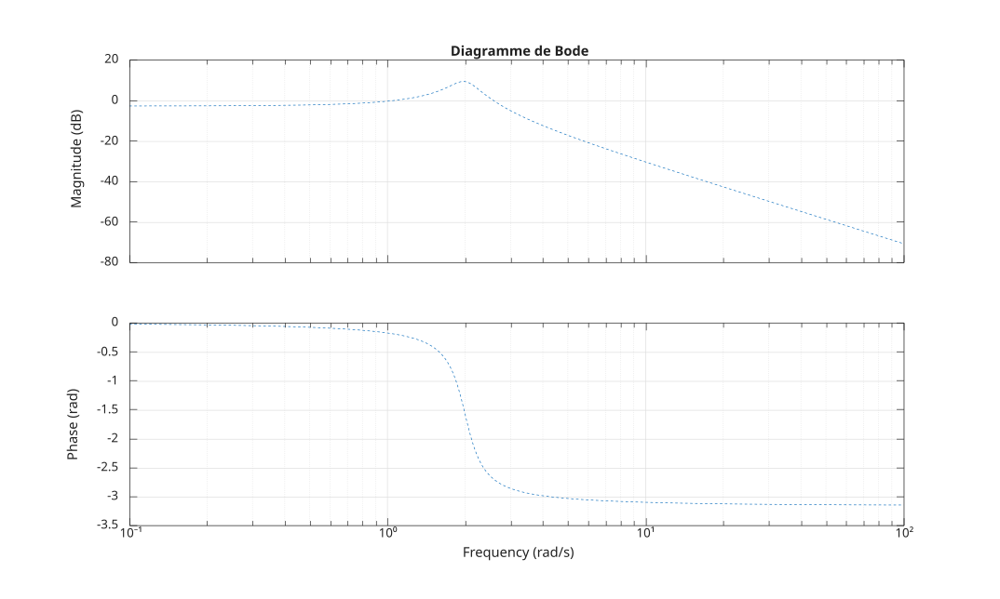

# bodeplot

Diagramme de Bode d'un système LTI SISO avec options de tracé.

## 📝 Syntaxe

- bodeplot(sys)
- bodeplot(sys, opt)
- bodeplot(sys, lineSpec)
- bodeplot(sys, opt, lineSpec)
- bodeplot(sys, w, ...)
- [magnitude, phase, w] = bodeplot(...)

## 📥 Argument d'entrée

- sys - un modèle LTI SISO.
- opt - une structure d'options renvoyée par bodeoptions.
- lineSpec - Style de ligne, marqueur et couleur.
- w - un cell {wmin, wmax} ou un vecteur de fréquences.

## 📤 Argument de sortie

- magnitude - Amplitude : taille 1 x 1 x k (SISO).
- phase - Phase : taille 1 x 1 x k (SISO).
- w - Fréquences : un vecteur 1 x k.

## 📄 Description


<b>bodeplot(sys)</b> génère un diagramme de Bode du système LTI SISO <b>sys</b>, comme <b>bode</b>. 

<b>bodeplot(sys, opt)</b> applique les options de tracé décrites par <b>opt</b> (voir <b>bodeoptions</b>). 

Lorsque <b>opt.PhaseUnits</b> vaut <b>'rad'</b>, la phase est tracée en radians. Lorsque <b>opt.Grid</b> vaut <b>'on'</b>, une grille est affichée. 

Un <b>lineSpec</b> et une spécification de fréquence <b>w</b> peuvent également être fournis, comme avec <b>bode</b>.

## 💡 Exemple


```matlab
G = tf([3], [1 1/2 4]);
opt = bodeoptions();
opt.PhaseUnits = 'rad';
opt.Grid = 'on';
f = figure();
bodeplot(G, opt, '--');

```



## 🔗 Voir aussi

[bode](../../control_system/3_linear_analysis/bode.md), [bodeoptions](../../control_system/3_linear_analysis/bodeoptions.md).

## 🕔 Historique

| Version | 📄 Description     |
| ------- | --------------- |
| 1.0.0   | version initiale |

<!--
## 👤 Auteur

Allan CORNET
-->
