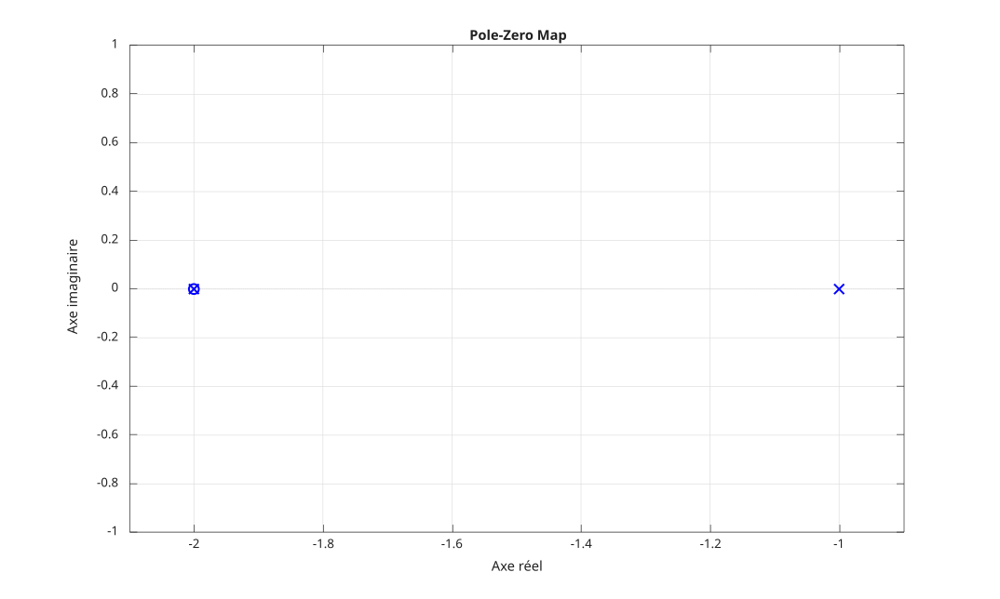

# pzmap

Carte des pôles et des zéros d'un système dynamique.

## 📝 Syntaxe

- pzmap(sys)
- [p, z] = pzmap(sys)

## 📥 Argument d'entrée

- sys - Système dynamique : un modèle LTI SISO.

## 📤 Argument de sortie

- p - Pôles du système.
- z - Zéros du système.

## 📄 Description


<b>pzmap(sys)</b> trace les pôles et les zéros du modèle de système dynamique <b>sys</b> dans le plan complexe. 

Chaque pôle est marqué d'un <b>x</b> et chaque zéro d'un <b>o</b>. 

Lorsque des arguments de sortie sont demandés, <b>[p, z] = pzmap(sys)</b> renvoie les pôles <b>p</b> et les zéros <b>z</b> sans produire de tracé.

## 💡 Exemples


```matlab
f = figure();
sys = tf([1 2], [1 3 2]);
pzmap(sys);

```



```matlab
sys = tf([1 2], [1 3 2]);
[p, z] = pzmap(sys)

```


## 🔗 Voir aussi

[pole](../../control_system/1_dynamic_system_models/pole.md), [zero](../../control_system/1_dynamic_system_models/zero.md), [bode](../../control_system/3_linear_analysis/bode.md).

## 🕔 Historique

| Version | 📄 Description     |
| ------- | --------------- |
| 1.0.0   | version initiale |

<!--
## 👤 Auteur

Allan CORNET
-->
