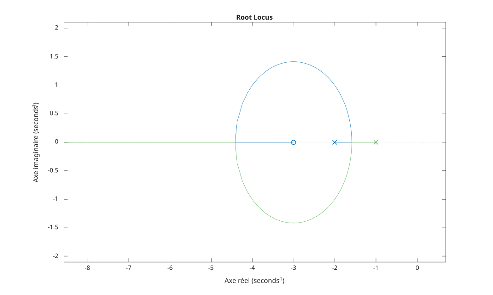

# rlocus

Lieu des racines d'un modèle SISO.

## 📝 Syntaxe

- rlocus(sys)
- rlocus(sys, k)
- rlocus(sys1, sys2, ...)
- [r, k] = rlocus(sys)
- [r, k] = rlocus(sys, k)

## 📥 Argument d'entrée

- sys - Système dynamique SISO
- k - Vecteur des gains de contre-réaction

## 📤 Argument de sortie

- r - Positions complexes des pôles en boucle fermée, une colonne par gain
- k - Vecteur des gains utilisés

## 📄 Description


La fonction du lieu des racines, <b>rlocus(sys)</b>, calcule et trace le lieu des pôles en boucle fermée de la boucle <b>feedback(k\*sys, 1)</b>, c'est-à-dire les racines de <b>den + k\*num</b>, lorsque le gain <b>k</b> varie de 0 à l'infini. 

Chaque branche part d'un pôle en boucle ouverte (marqué <b>x</b>) pour <b>k = 0</b> et se termine sur un zéro fini en boucle ouverte (marqué <b>o</b>) ou tend vers l'infini lorsque <b>k</b> augmente. 

Lorsqu'un vecteur de gains <b>k</b> est fourni, ces gains sont utilisés à la place de la plage sélectionnée automatiquement. 

Avec des arguments de sortie, <b>[r, k] = rlocus(sys)</b> renvoie les positions des pôles en boucle fermée et les gains sans tracer.

## 💡 Exemples


```matlab
f = figure();
sys = tf([1 3], [1 3 2]);
rlocus(sys);

```



```matlab
G = tf(1, [1 3 2]);
[r, k] = rlocus(G);

```


## 🔗 Voir aussi

[nyquist](../../control_system/3_linear_analysis/nyquist.md), [bode](../../control_system/3_linear_analysis/bode.md).

## 🕔 Historique

| Version | 📄 Description     |
| ------- | --------------- |
| 1.0.0   | initial version |

<!--
## 👤 Auteur

Allan CORNET
-->
