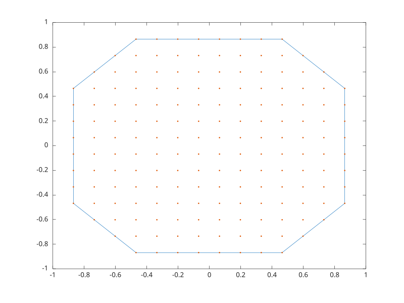

# alphaShape

Objet alpha shape

## 📝 Syntaxe

- SHP = alphaShape(P)
- SHP = alphaShape(x, y)
- SHP = alphaShape(x, y, z)
- SHP = alphaShape(..., alpha)
- SHP = alphaShape(..., 'HoleThreshold', value, 'RegionThreshold', value)
- K = boundaryFacets(SHP)
- A = area(SHP)
- plot(SHP)

## 📄 Description


<b>alphaShape</b> stocke des points et parametres alpha pour les requetes de frontiere et de forme.

## 💡 Exemple

Creer et tracer un alpha shape.

```matlab
[x, y] = meshgrid(linspace(-1, 1, 16));
P = [x(:), y(:)];
P(hypot(P(:, 1), P(:, 2)) > 1, :) = [];
SHP = alphaShape(P, 0.3);
A = area(SHP);
plot(SHP)
hold('on')
plot(P(:, 1), P(:, 2), '.')
```



## 🔗 Voir aussi

[boundary](../geometry/boundary.md), [convhull](../geometry/convhull.md).

## 🕔 Historique

| Version | 📄 Description     |
| ------- | --------------- |
| 2.0.0   | Version initiale. |

<!--
## 👤 Auteur

Allan CORNET
-->
