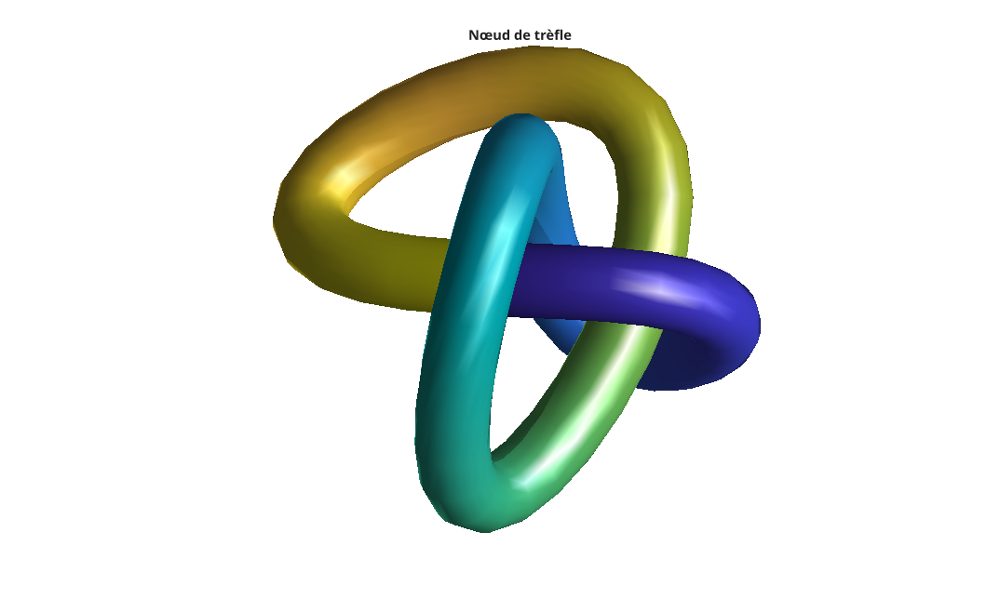

# knot

Créer une surface en nœud de trèfle.

## 📝 Syntaxe

- [X, Y, Z] = knot()
- [X, Y, Z] = knot(n)
- knot()
- knot(n)
- knot(ax, n)

## 📥 Argument d'entrée

- n - Nombre de facettes autour de la section du tube : entier positif (16 par défaut).
- ax - Axes cibles : objet 'axes'.

## 📤 Argument de sortie

- X, Y, Z - Coordonnées x, y et z de la surface du nœud sans l'afficher.

## 📄 Description


<b>knot</b> construit et affiche un tube lisse balayé autour d'une courbe de nœud de trèfle (le nœud torique (2,3) classique). 

La courbe est analytique : le tube est engendré en balayant une section circulaire le long du repère de Frenet (tangente, normale principale et binormale) de la courbe.

## 💡 Exemple


```matlab
f = figure();
knot();
axis equal
title('Nœud de trèfle');
```



## 🔗 Voir aussi

[sphere](../../../graphics/1_plots/7_surfaces_volumes_polygons/sphere.md), [cylinder](../../../graphics/1_plots/7_surfaces_volumes_polygons/cylinder.md), [surf](../../../graphics/1_plots/7_surfaces_volumes_polygons/surf.md).

## 🕔 Historique

| Version | 📄 Description     |
| ------- | --------------- |
| 1.0.0   | version initiale |

<!--
## 👤 Auteur

Allan CORNET
-->
