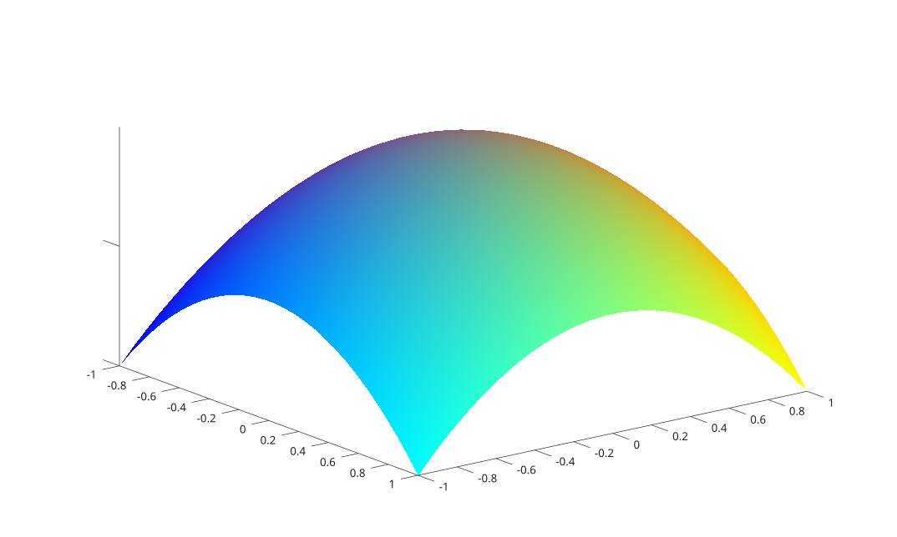

# warp

Affiche une image plaquée en texture sur une surface.

## 📝 Syntaxe

- warp(X, Y, Z, A)
- warp(Z, A)
- warp(Z, A, map)
- warp(X, Y, Z, A, map)
- h = warp(...)

## 📥 Argument d'entrée

- X, Y, Z - Coordonnées de la surface. X et Y peuvent être des vecteurs ou des matrices ; Z est une matrice. Lorsqu'ils sont omis (formes warp(Z, A)), X et Y sont construits à partir de la taille de Z.
- A - Image plaquée sur la surface : image indexée (M-par-N) ou image couleur vraie (M-par-N-par-3). Sa taille est indépendante de la grille de la surface.
- map - Table de couleurs (P-par-3) utilisée lorsque A est une image indexée. Elle est appliquée aux axes courants.

## 📤 Argument de sortie

- h - Handle de l'objet surface créé.

## 📄 Description


Affiche l'image <b>A</b> plaquée en texture sur la surface définie par <b>X</b>, <b>Y</b> et <b>Z</b>. 

L'image est plaquée par fragment : elle reste nette quelle que soit la finesse de la grille de la surface ; sa résolution est indépendante du nombre de points de la surface. 

La surface créée a <b>FaceColor</b> à <b>texturemap</b>, <b>EdgeColor</b> à <b>none</b> et <b>CDataMapping</b> à <b>direct</b>. Les axes sont affichés avec une direction Y inversée et une vue 3-D par défaut. 

Cela équivaut à créer une surface et à fixer sa propriété <b>FaceColor</b> à <b>texturemap</b> avec l'image comme <b>CData</b>.

## 💡 Exemple

Plaquer un dégradé de couleurs sur un dôme

```matlab
n = 64;
[tx, ty] = meshgrid(linspace(0, 1, n), linspace(0, 1, n));
A = zeros(n, n, 3);
A(:, :, 1) = tx;
A(:, :, 2) = ty;
A(:, :, 3) = 1 - tx;
[X, Y] = meshgrid(linspace(-1, 1, 30), linspace(-1, 1, 30));
Z = 1 - (X .^ 2 + Y .^ 2);
figure;
warp(X, Y, Z, A);
```



## 🔗 Voir aussi

[surface](../../../graphics/1_plots/7_surfaces_volumes_polygons/surface.md), [surf](../../../graphics/1_plots/7_surfaces_volumes_polygons/surf.md), [imwarp](../../../image_processing/3_geometry_registration_3d/6_geometric_transforms/imwarp.md).

## 🕔 Historique

| Version | 📄 Description     |
| ------- | --------------- |
| 2.0.0   | initial version |

<!--
## 👤 Auteur

Allan CORNET
-->
