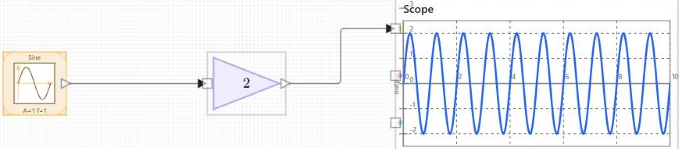

# nflow\_tutorial\_first\_model

Tutoriel 1 sur 3 : construire, câbler et exécuter un premier modèle nflow.

## 📝 Syntaxe

- Tutoriel : poser trois blocs, les relier, exécuter et lire le scope.

## 📄 Description

Ceci est le premier de trois courts tutoriels. Vous construisez un modèle à trois blocs, une source Sine, un Gain et un Scope, puis vous l'exécutez et lisez le résultat. Le modèle n'a ni rebouclage ni dynamique : c'est donc une bonne façon d'apprendre l'éditeur lui-même, à savoir poser des blocs, tracer des fils, modifier des paramètres et lancer une simulation. 

<b>Ouvrir l'éditeur</b> 

Appelez <b>nflow()</b> depuis la ligne de commande Nelson pour ouvrir un modèle vide. La bibliothèque de blocs est à gauche, le diagramme au centre et l'inspecteur à droite. Sélectionnez un bloc pour voir ses paramètres dans l'inspecteur, ou ne sélectionnez rien pour afficher l'onglet <b>Modèle</b> et ses réglages de simulation. 

<b>Poser les blocs</b> 
2. Dans la bibliothèque, ouvrez le groupe <b>Source</b> et faites glisser un bloc <b>Sine</b> sur le diagramme. 
4. Ouvrez le groupe <b>Math</b> et faites glisser un bloc <b>Gain</b> à droite du bloc Sine. 
6. Ouvrez le groupe <b>Sinks</b> et faites glisser un bloc <b>Scope</b> à droite du bloc Gain.
 

Laissez de l'espace entre les blocs pour que les fils aient la place de se router. 

<b>Relier les blocs</b> 
2. Placez le pointeur sur le port de sortie à droite du bloc Sine, puis glissez jusqu'au port d'entrée à gauche du bloc Gain. Relâchez pour créer le fil. 
4. Tracez un second fil de la même manière, de la sortie du Gain vers l'entrée du Scope.
 

Lorsque <b>autoRoute</b> est actif, l'éditeur garde les fils orthogonaux et lisibles quand vous déplacez les blocs. Voir <b>nflow\_wire\_editing</b> pour le routage manuel, les coins et les jonctions. 

 

<b>Régler les paramètres des blocs</b> 

Sélectionnez le bloc <b>Gain</b> et réglez <b>Gain</b> à 2 dans l'inspecteur. Sélectionnez le bloc <b>Sine</b> pour régler son amplitude et sa fréquence, ou conservez les valeurs par défaut. Chaque modification est appliquée au bloc au fur et à mesure de la saisie. 

<b>Régler la durée de simulation</b> 

Ne sélectionnez rien pour afficher l'onglet <b>Modèle</b>, puis ouvrez <b>Simulation</b>. Réglez <b>Temps d'arrêt (s)</b> sur la durée de l'exécution, par exemple 10. Conservez <b>Temps d'échantillonnage (s)</b> à sa valeur par défaut pour ce modèle. 

<b>Exécuter le modèle</b> 

Appuyez sur <b>Exécuter</b> dans la barre d'outils au-dessus du diagramme, ou utilisez le menu <b>Simulation</b>. Le Scope se remplit pendant l'exécution. <b>Arrêter</b> arrête l'exécution et conserve les résultats déjà calculés. <b>Réinitialiser</b> remet le temps à zéro et efface les résultats affichés. 

<b>Lire le scope</b> 

Le Scope montre le sinus amplifié. Sélectionnez le Scope et utilisez l'inspecteur pour régler les plages de temps et de valeurs (<b>t min</b>, <b>t max</b>, <b>y min</b>, <b>y max</b>), afficher les graduations, et définir la couleur du tracé et les libellés d'axes. Laissez un champ de plage vide pour que le Scope s'ajuste aux données. 

<b>Pour aller plus loin</b> 

Remplacez le Sine par un <b>Step</b> ou un <b>Pulse</b> du groupe Source pour voir comment la sortie suit une entrée différente. Poursuivez ensuite avec <b>nflow\_tutorial\_continuous</b> pour ajouter un intégrateur et choisir un solveur.

## 🔗 Voir aussi

[nflow](../nflow_gui/nflow.md), [nflow_workspace](../nflow_gui/nflow_workspace.md), [nflow_wire_editing](../nflow_gui/nflow_wire_editing.md), [nflow_tutorial_continuous](../nflow_gui/2_nflow_tutorial_continuous.md), [nflow_tutorial_dashboard](../nflow_gui/3_nflow_tutorial_dashboard.md).

## 🕔 Historique

| Version | 📄 Description     |
| ------- | --------------- |
| 1.0.0   | version initiale |

<!--
## 👤 Auteur

Allan CORNET
-->
