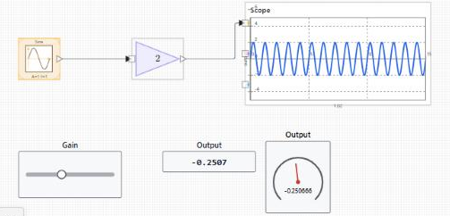
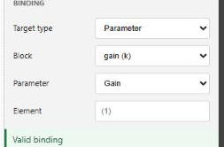

# nflow\_tutorial\_dashboard

Tutoriel 3 sur 3 : ajouter des commandes dashboard interactives et exécuter en temps réel.

## 📝 Syntaxe

- Tutoriel : lier un slider, un afficheur et une jauge, puis exécuter et ajuster en direct.

## 📄 Description


Ce troisième tutoriel ajoute des commandes interactives à un modèle en cours d'exécution. Vous posez un Slider, un Display et un Gauge, vous les liez au modèle, et vous exécutez en temps réel pour changer un paramètre et observer la réponse. Il fait suite au modèle construit dans <b>nflow\_tutorial\_continuous</b>, mais tout modèle avec un paramètre ajustable et un signal de sortie convient. 

<b>Poser les blocs dashboard</b> 
2. Depuis le groupe <b>Dashboard</b>, faites glisser un <b>Slider</b> sur le diagramme. 
4. Faites glisser un <b>Display</b> à côté. 
6. Faites glisser un <b>Gauge</b> à côté du Display.
 

Les blocs dashboard n'ont ni port d'entrée ni port de sortie. Chacun lit ou écrit une cible que vous choisissez dans l'inspecteur, ils se posent donc n'importe où sur le diagramme sans fils. 



 

<b>Lier les commandes</b> 
2. Sélectionnez le <b>Slider</b>. Dans la section <b>Liaison</b> de l'inspecteur, réglez le type sur <b>Paramètre</b>, puis choisissez un bloc et l'un de ses paramètres ajustables, par exemple le Gain du modèle. Réglez les limites du slider. 
4. Sélectionnez le <b>Display</b>. Réglez le type de liaison sur <b>Signal</b>, puis choisissez une sortie de bloc et son port en numérotation à partir de un. 
6. Sélectionnez le <b>Gauge</b>. Liez-le à un signal de la même façon et réglez ses limites.
 

L'état sous le sélecteur de liaison indique si la liaison est valide ou pourquoi elle ne l'est pas. Les liaisons utilisent des identifiants de bloc stables : renommer ou déplacer un bloc ne les casse pas. Voir <b>nflow\_dashboard</b> pour toutes les commandes et tous les afficheurs, ainsi que pour les cibles de type signal, paramètre et variable. 



 

<b>Régler le mode d'exécution</b> 

Ne sélectionnez rien pour afficher l'onglet Modèle, puis ouvrez <b>Simulation</b> et réglez <b>Exécution</b>. <b>Temps réel</b> cadence l'exécution sur l'horloge réelle, donc une seconde de temps simulé prend environ une seconde, ce qui est utile pour ajuster les commandes à la main. <b>Rapide</b> exécute aussi vite que la machine le permet. <b>Auto</b> laisse le modèle décider. 

Le mode d'exécution est lu au démarrage de l'exécution. Réglez-le avant d'appuyer sur <b>Exécuter</b>. Le changer pendant qu'une simulation tourne n'a pas d'effet sur cette exécution ; il s'applique à la suivante. C'est différent d'une commande dashboard liée à un paramètre, dont le changement est pris en compte pendant l'exécution, au pas suivant. 

<b>Exécuter et interagir</b> 

Appuyez sur <b>Exécuter</b>. Pendant l'exécution, faites glisser le Slider pour changer son paramètre lié. Le Display et le Gauge se mettent à jour à chaque pas majeur, et le Scope montre comment la réponse change. Un geste de pointeur qui commence sur une commande reste attaché à cette commande jusqu'au relâchement, ce qui permet de glisser un slider sans déplacer le bloc. Pour déplacer le bloc à la place, faites glisser son corps en dehors de la zone de commande. 

<b>Pour aller plus loin</b> 

Ajoutez un <b>Lamp</b> ou un <b>Gauge</b> avec des plages colorées pour signaler un seuil, ou un <b>Push Button</b> pour basculer un paramètre entre deux états. Ouvrez les exemples exécutables ci-dessous pour voir un panneau interactif complet.

## 💡 Exemples

Ouvrir un modèle avec des afficheurs de signaux en direct et un Slider lié.

```matlab
open_system([modulepath('nflow_blocks', 'root'), '/examples/dashboard/Dashboard_Runtime_Demo.nflow']);
```
Ouvrir la galerie contenant tous les blocs dashboard.

```matlab
open_system([modulepath('nflow_blocks', 'root'), '/examples/dashboard/Dashboard_Gallery_Demo.nflow']);
```


## 🔗 Voir aussi

[nflow_dashboard](../nflow_gui/nflow_dashboard.md), [nflow_workspace](../nflow_gui/nflow_workspace.md), [nflow_tutorial_first_model](../nflow_gui/1_nflow_tutorial_first_model.md), [nflow_tutorial_continuous](../nflow_gui/2_nflow_tutorial_continuous.md).

## 🕔 Historique

| Version | 📄 Description     |
| ------- | --------------- |
| 1.0.0   | version initiale |

<!--
## 👤 Auteur

Allan CORNET
-->
