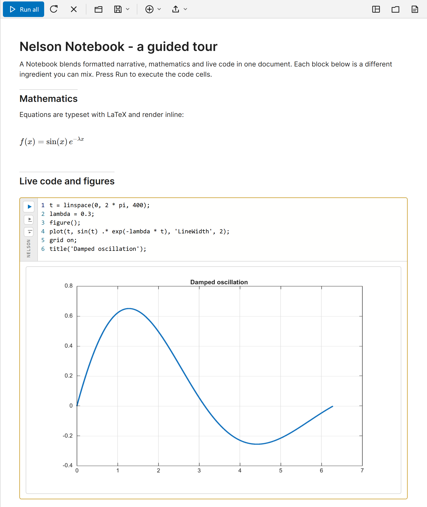

# Votre premier Notebook Nelson

Créer, exécuter et enregistrer votre premier document Notebook.

## 📄 Description

Un <b>Notebook</b> est un document unique qui réunit du texte mis en forme, du code Nelson et la sortie de ce code, dans l'ordre que vous choisissez. Il est construit à partir de <b>blocs</b> : un titre, un paragraphe, une cellule de code, une équation ou un contrôle interactif. Exécuter une cellule de code affiche sa sortie texte et ses figures juste en dessous du code, si bien que l'explication, le calcul et le résultat restent ensemble. 

Toutes les cellules de code d'un même document partagent un seul espace de travail, le même espace de travail de base que celui de la ligne de commande. Une variable créée dans une cellule est visible dans les cellules qui s'exécutent ensuite. Ce tutoriel crée un document, l'exécute et l'enregistre. 

<b>Ouvrir l'éditeur</b> 

La fonction <b>notebook</b> ouvre l'éditeur Notebook : 

- <b>notebook()</b> sans argument ouvre un nouveau document vide. 
- <b>notebook(filename, 'edit')</b> ouvre un document existant, et <b>edit(filename)</b> fait de même pour un fichier <b>.nlx</b>. 

Sur le bureau Nelson, vous pouvez aussi utiliser le bouton <b>Nouveau Notebook</b> de la barre d'outils, ou le menu <b>Fenêtre</b>. L'éditeur s'ouvre comme un onglet du bureau web ou, sur le bureau Qt, comme la fenêtre Notebook (une seule fenêtre, un onglet par document). Sans bureau (nelson-cli, nelson-adv-cli), l'éditeur ne peut pas s'ouvrir et l'appel signale une erreur. 

L'éditeur affiche une barre d'outils en haut et le document en dessous. Un nouveau document contient déjà un court exemple que vous pouvez exécuter et modifier. 

 

<b>Ajouter du texte et du code</b> 

Cliquez dans le document et saisissez du texte. Appuyez sur <b>Entrée</b> pour commencer un nouveau bloc. Pour insérer autre chose qu'un paragraphe, tapez <b>/</b> en début de ligne et choisissez un élément dans la liste, ou utilisez le menu <b>Insérer</b> de la barre d'outils. Choisissez <b>Cellule de code</b> pour ajouter une cellule et y saisir du code Nelson, par exemple : 

<code>x = linspace(0, 2 * pi, 200);</code> 

<code>plot(x, sin(x))</code> 

<b>Exécuter une cellule</b> 

Chaque cellule de code a un bouton d'exécution dans sa marge de gauche. Cliquez dessus pour exécuter cette seule cellule, ou cliquez sur <b>Tout exécuter</b> dans la barre d'outils pour exécuter toutes les cellules de code de haut en bas. La sortie texte apparaît sous la cellule, et toute figure dessinée par la cellule est affichée en ligne, dans le document, au lieu d'une fenêtre figure séparée. 

<b>L'espace de travail partagé</b> 

Comme les cellules partagent un seul espace de travail, vous pouvez répartir un calcul sur plusieurs cellules. La valeur fixée dans une cellule antérieure est utilisée par une cellule ultérieure : 
2. Première cellule : <code>N = 200;</code> 
4. Deuxième cellule : <code>x = linspace(0, 2 * pi, N);</code> 
6. Troisième cellule : <code>plot(x, sin(x))</code>
 

Ce qui compte, c'est l'ordre dans lequel les cellules s'exécutent, pas leur position sur la page. Si une cellule ultérieure signale une variable inconnue, exécutez d'abord les cellules antérieures, ou utilisez <b>Tout exécuter</b>. 

<b>Enregistrer votre travail</b> 

Utilisez <b>Enregistrer</b> dans la barre d'outils pour écrire le document sous forme de fichier <b>.nlx</b>, le format Notebook natif. Le conteneur <b>.nlx</b> garde le texte, le code, la sortie enregistrée et les figures ensemble dans un seul fichier portable. Vous pouvez aussi enregistrer le document comme un script texte <b>.m</b> avec <b>Enregistrer comme script</b>. Rouvrez un document enregistré avec <b>Open</b>, avec <b>edit(filename)</b> ou avec <b>notebook(filename, 'edit')</b>. 

<b>Pour continuer</b> 

Les tutoriels suivants décrivent les types de blocs et les contrôles interactifs, et comment exécuter ou partager un document sans l'éditeur.

## 🔗 Voir aussi

[Cellules et contrôles d'un Notebook](../notebook/2_notebook_cells_and_controls.md), [Exécuter et partager un Notebook](../notebook/3_notebook_run_and_share.md), [notebook](../notebook/notebook.md), [nlx](../notebook/nlx.md).

## 🕔 Historique

| Version | 📄 Description     |
| ------- | --------------- |
| 2.0.0   | version initiale |

<!--
## 👤 Auteur

Allan CORNET
-->
