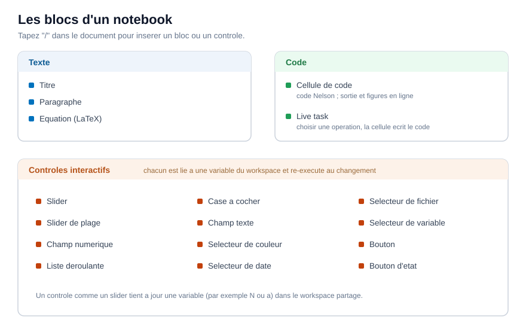

# Cellules et contrôles d'un Notebook

Les types de blocs d'un Notebook et les contrôles interactifs.

## 📄 Description

Un Notebook est une suite de <b>blocs</b>. Certains blocs sont du texte, un bloc exécute du code, et d'autres sont des contrôles interactifs qui pilotent une variable. Vous insérez chacun d'eux en tapant <b>/</b> dans le document, ou depuis le menu <b>Insert</b> de la barre d'outils. 

 

<b>Blocs de texte</b> 

Un <b>titre</b> et un <b>paragraphe</b> contiennent du texte mis en forme : des titres, des mots en gras ou en italique, et des listes. Ils portent l'explication autour du code et ne s'exécutent jamais. 

<b>Équations</b> 

Un bloc <b>équation</b> contient une formule LaTeX et l'affiche en ligne, à côté de votre texte. Par exemple <code>f(x) = \sin(x)\,e^{-\lambda x}</code> est composé comme une expression mathématique. Les équations servent uniquement à l'affichage ; elles ne sont pas évaluées. 

<b>Cellules de code</b> 

Une <b>cellule de code</b> contient du code Nelson. Sa marge de gauche a trois boutons d'exécution : exécuter cette cellule, exécuter jusqu'à cette cellule, et exécuter la section (une cellule de code avec le texte et les contrôles au-dessus, jusqu'au titre précédent). La barre d'outils ajoute <b>Run all</b> pour tout le document. 

Quand vous modifiez une cellule, les cellules dont le résultat peut être périmé sont marquées. <b>Exécuter les périmées</b> ré-exécute seulement celles-ci et les cellules qui en dépendent, au lieu de tout le document. <b>Effacer</b> supprime toutes les sorties enregistrées. 

<b>Tâche interactive</b> 

Une <b>tâche interactive</b> est une cellule à cliquer : vous choisissez une opération et ses entrées, et la cellule écrit le code Nelson à votre place et l'exécute. C'est une manière rapide de construire une étape sans écrire le code à la main. 

<b>Contrôles interactifs</b> 

Un contrôle est lié à une variable de l'espace de travail. Quand vous déplacez ou modifiez le contrôle, il fixe cette variable et ré-exécute les cellules qui l'utilisent, si bien qu'une figure se met à jour pendant que vous ajustez une valeur. Les contrôles disponibles sont : 

- <b>Curseur</b> et <b>curseur d’intervalle</b> - un nombre, ou un couple bas et haut, pris dans une plage continue. 
- <b>Champ numérique</b> - un nombre unique saisi ou incrémenté. 
- <b>Liste déroulante</b> - une valeur choisie dans une liste. 
- <b>Case à cocher</b> et <b>bouton d'état</b> - un logique vrai ou faux. 
- <b>Champ texte</b> - un court texte ou nombre. 
- <b>Sélecteur de couleur</b> - une couleur, sous forme de triplet RVB. 
- <b>Sélecteur de date</b> - une date, sous forme de texte. 
- <b>Sélecteur de fichier</b> - un chemin de fichier. 
- <b>Sélecteur de variable</b> - une variable existante du workspace, transmise sous un nouveau nom. 
- <b>Bouton</b> - exécute les cellules à la demande, sans lier de variable. 

Par exemple, un curseur nommé <b>Frequency</b> lié à la variable <code>frequency</code> fixe cette variable à chaque déplacement, et une cellule qui trace <code>sin(frequency * x)</code> se redessine aussitôt. 

<b>Une vue partageable</b> 

<b>Masquer le code</b> replie les cellules de code et garde le texte, les contrôles et la sortie, ce qui transforme le document en un court rapport utilisable sans voir le code. <b>Plan</b> liste les titres pour parcourir un long document.

## 🔗 Voir aussi

[Votre premier Notebook Nelson](../notebook/1_notebook_first_steps.md), [Exécuter et partager un Notebook](../notebook/3_notebook_run_and_share.md), [nlx](../notebook/nlx.md).

## 🕔 Historique

| Version | 📄 Description     |
| ------- | --------------- |
| 2.0.0   | version initiale |

<!--
## 👤 Auteur

Allan CORNET
-->
