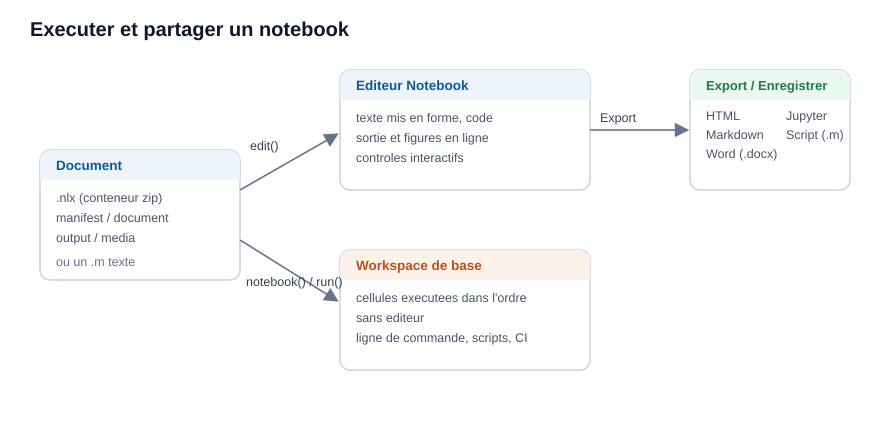

# Exécuter et partager un Notebook

Exécuter un Notebook sans l'éditeur, puis l'exporter ou l'importer.

## 📄 Description


Un document Notebook est plus qu'une vue d'éditeur. Le même fichier s'exécute depuis la ligne de commande, s'enregistre et voyage sous forme d'un seul fichier portable, et se convertit depuis et vers d'autres formats. 



 

<b>Exécuter sans l'éditeur</b> 

<b>notebook(filename)</b> exécute un document sans l'ouvrir : il lit le code de chaque cellule de code, dans l'ordre, et l'évalue dans l'espace de travail de base, exactement comme le ferait l'éditeur. <b>run(filename)</b> sur un fichier <b>.nlx</b> fait de même. C'est ainsi qu'un document s'exécute depuis nelson-cli ou dans un traitement par lots, là où aucun éditeur n'est disponible. Les blocs de texte, les titres, les équations et les contrôles sont ignorés ; seules les cellules de code s'exécutent. 

<b>Le conteneur .nlx</b> 

Le fichier natif <b>.nlx</b> est un conteneur zip. Il garde la source (<b>document.json</b>), la sortie enregistrée (<b>output.json</b>) et les figures (<b>media/</b>) à part, si bien que la source reste petite et lisible, tandis que les figures enregistrées voyagent avec elle. La page de référence <b>nlx</b> décrit chaque entrée. 

<b>La forme texte .m</b> 

Un Notebook peut aussi être enregistré comme un script texte <b>.m</b>, où chaque bloc est écrit sous un marqueur <code>%% [kind]</code> (par exemple <code>%% [code]</code> ou <code>%% [text]</code>). Ce fichier s'ouvre dans n'importe quel éditeur de texte et s'exécute comme un script ordinaire. Un fichier <b>.m</b> sans un tel marqueur est traité comme une seule cellule de code et exécuté en entier. 

<b>Export et import</b> 

Depuis le menu <b>Exporter</b>, un document est écrit en <b>HTML</b>, <b>Markdown</b>, <b>Word (.docx)</b> ou en notebook <b>Jupyter (.ipynb)</b>, et <b>Enregistrer comme script</b> écrit la forme texte <b>.m</b>. <b>Ouvrir</b> relit un document <b>.nlx</b>, un script <b>.m</b> ordinaire ou un notebook <b>.ipynb</b> dans l'éditeur. 

<b>Vérifier qu'un document s'exécute de bout en bout</b> 

Un document est fiable quand il s'exécute depuis un espace de travail vide, dans l'ordre, sans erreur. Comme les cellules partagent l'espace de travail de base, une variable laissée par une session antérieure peut masquer une étape manquante. Pour vérifier, exécutez le document dans une session neuve, par exemple avec <code>nelson-cli</code> et <b>notebook(filename)</b> ; si une cellule échoue, l'exécution s'arrête sur l'erreur. Ce même contrôle convient à un travail d'intégration continue. 

L'exemple ci-dessous construit un document <b>.nlx</b> minimal et l'exécute sans l'éditeur.

## 💡 Exemple

Construire un document Notebook (.nlx) et l'exécuter sans éditeur.

```matlab
% écrit la source d'un document à une cellule
d = [tempdir(), createGUID()];
mkdir(d);
fw = fopen([d, '/document.json'], 'wt');
fwrite(fw, '{"blocks":[{"type":"codecell","props":{"code":"answer = 6 * 7;"}}]}');
fclose(fw);
fw = fopen([d, '/manifest.json'], 'wt');
fwrite(fw, '{"format":"nelson-notebook","version":1}');
fclose(fw);
% l'empaquette comme un conteneur .nlx
nlx = [tempdir(), createGUID(), '.nlx'];
odir = pwd();
cd(d);
zip(nlx, '*.json');
cd(odir);
% l'exécute : la cellule de code est évaluée dans l'espace de travail de base
notebook(nlx);
answer
```


## 🔗 Voir aussi

[Votre premier Notebook Nelson](../notebook/1_notebook_first_steps.md), [Cellules et contrôles d'un Notebook](../notebook/2_notebook_cells_and_controls.md), [notebook](../notebook/notebook.md), [nlx](../notebook/nlx.md), [run](../core/run.md).

## 🕔 Historique

| Version | 📄 Description     |
| ------- | --------------- |
| 2.0.0   | version initiale |

<!--
## 👤 Auteur

Allan CORNET
-->
