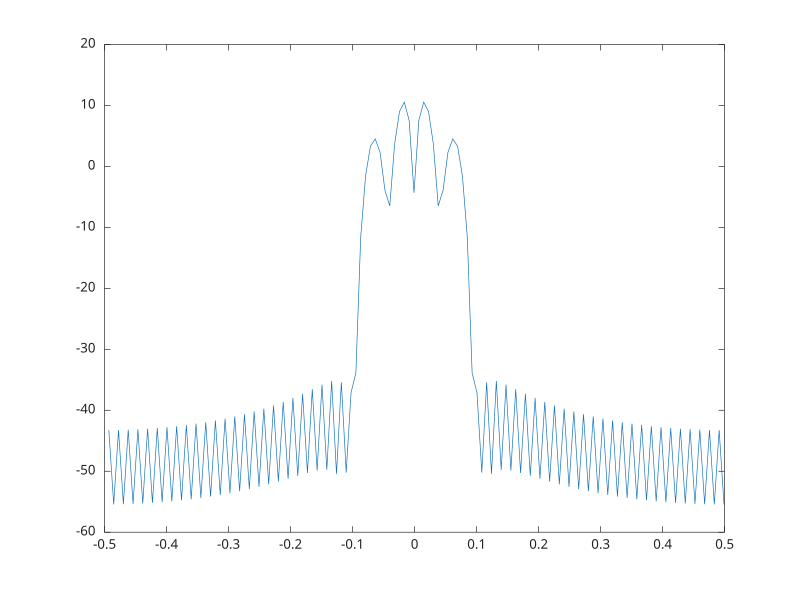

# pwelch

Estimation spectrale par la methode de Welch.

## 📝 Syntaxe

- [Pxx, F] = pwelch(X)
- [Pxx, F] = pwelch(X, window, noverlap, NFFT, Fs)
- [Pxx, F] = pwelch(..., FREQRANGE)
- [Pxx, F] = pwelch(..., SPECTRUMTYPE)

## 📥 Argument d'entrée

- X - signal d'entree.
- window - vecteur de fenetre ou longueur.
- noverlap - nombre d'echantillons de recouvrement.
- NFFT - longueur de FFT.
- Fs - frequence d'echantillonnage.
- FREQRANGE - <code>'onesided'</code>, <code>'twosided'</code>, <code>'centered'</code>, <code>'half'</code> ou <code>'whole'</code>.
- SPECTRUMTYPE - <code>'psd'</code> ou <code>'power'</code>.

## 📤 Argument de sortie

- Pxx - estimation spectrale moyennee.
- F - vecteur de frequences.

## 📄 Description


<b>pwelch</b> estime un spectre en moyennant des periodogrammes de segments recouvrants.

## 💡 Exemples


```matlab

[pxx, f] = pwelch(rand(256, 1), hamming(64), 32, 128, 1, 'centered');

```
Tracer la densite spectrale de puissance par la methode de Welch.

```matlab
pwelch(sin((0:255)' * 0.1) + 0.5 * sin((0:255)' * 0.4), hamming(64), 32, 128, 1, 'centered');
```



## 🔗 Voir aussi

[periodogram](../../signal_processing/5_spectral_analysis/periodogram.md), [cpsd](../../signal_processing/3_transforms_correlation_modeling/cpsd.md).

## 🕔 Historique

| Version | 📄 Description     |
| ------- | --------------- |
| 2.0.0   | version initiale |

<!--
## 👤 Auteur

Allan CORNET
-->
