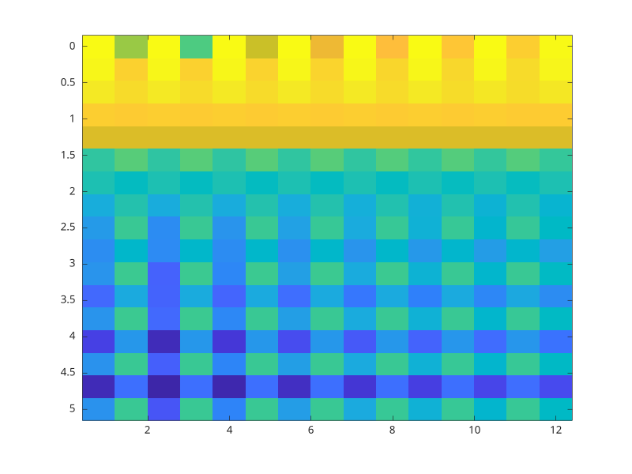

# stft

Transformee de Fourier court terme.

## 📝 Syntaxe

- [S, F, T] = stft(X)
- [S, F, T] = stft(X, Fs)
- [S, F, T] = stft(X, Fs, 'Window', window, 'OverlapLength', overlap, 'FFTLength', nfft)
- [S, F, T] = stft(..., 'FrequencyRange', range)

## 📥 Argument d'entrée

- X - vecteur d'entree.
- Fs - frequence d'echantillonnage. La valeur par defaut vaut 1.
- window - fenetre d'analyse. La valeur par defaut vaut hamming(128).
- overlap - longueur de recouvrement. Elle doit etre inferieure a la longueur de la fenetre.
- nfft - longueur FFT. Elle doit etre superieure ou egale a la longueur de la fenetre.
- range - plage de frequences : 'centered', 'twosided' ou 'onesided'.

## 📤 Argument de sortie

- S - matrice de transformee court terme.
- F - vecteur de frequences.
- T - vecteur de temps.

## 📄 Description


<b>stft</b> decoupe le vecteur d'entree en trames fenetrees recouvrantes puis calcule une FFT par trame. La sortie peut etre centree, bilaterale ou unilaterale.

## 💡 Exemples


```matlab

[s, f, t] = stft(sin((0:31)' * 0.2), 10, 'Window', hamming(8), 'OverlapLength', 4, 'FFTLength', 16, 'FrequencyRange', 'onesided');

```
Afficher la transformee de Fourier a court terme.

```matlab
stft(sin((0:127)' * 0.2), 10, 'Window', hamming(16), 'OverlapLength', 8, 'FFTLength', 32, 'FrequencyRange', 'onesided');
```



## 🔗 Voir aussi

[istft](../../signal_processing/6_time_frequency_analysis/istft.md), [spectrogram](../../signal_processing/6_time_frequency_analysis/spectrogram.md).

## 🕔 Historique

| Version | 📄 Description     |
| ------- | --------------- |
| 2.0.0   | version initiale |

<!--
## 👤 Auteur

Allan CORNET
-->
