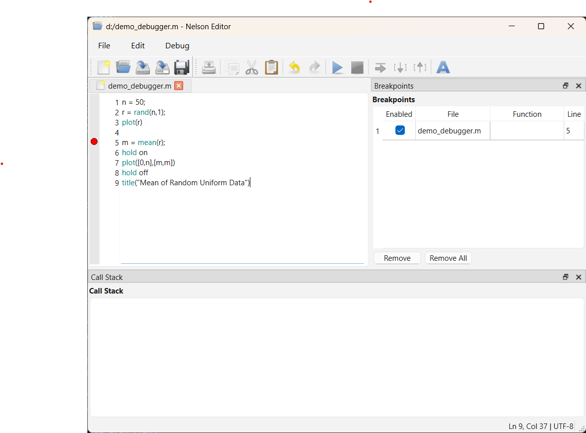
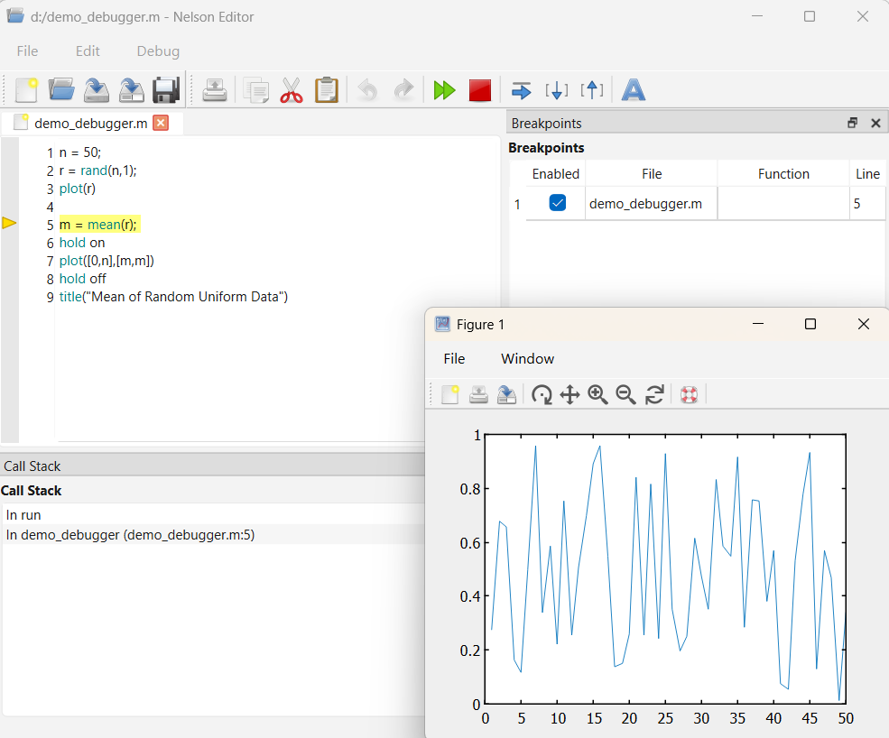

# debugging workflow

Déroulement d'une session de débogage des fichiers Nelson dans l'éditeur.

## 📄 Description


Le débogueur de Nelson fournit des outils interactifs pour diagnostiquer et corriger les scripts et fonctions en contrôlant l'exécution et en inspectant l'état du programme. Le bureau Qt et le bureau web exposent les mêmes commandes, touches, couleurs de marqueurs et libellés. 

Avant de déboguer, enregistrez les fichiers. Les points d'arrêt appartiennent au fichier enregistré : tant qu'un fichier a des modifications non enregistrées, ses marqueurs deviennent gris foncé (invalides) et sont réappliqués sur leurs nouvelles lignes à l'enregistrement. Enregistrer un fichier pendant une pause termine la session de débogage. 

<b>Points d'arrêt</b> 

Cliquez dans la marge gauche à côté du numéro de ligne, ou appuyez sur <b>F12</b> sur la ligne, pour poser ou retirer un point d'arrêt standard (rouge). Un point d'arrêt demandé sur un commentaire, une ligne vide ou une ligne <code>function</code> glisse vers la ligne exécutable suivante ; le <code>end</code> d'une boucle ou d'une fonction est une ligne d'arrêt à part entière. Les lignes <code>else</code>, <code>elseif</code>, <code>case</code>, <code>otherwise</code> et <code>catch</code> glissent vers l'instruction suivante. 

Un clic droit dans la marge ouvre le menu des points d'arrêt : <b>Set/Clear Breakpoint</b>, <b>Set/Modify Condition...</b> (point d'arrêt conditionnel, orange : l'exécution ne s'arrête que si l'expression est vraie ; une expression en erreur ou non scalaire affiche un avertissement et s'arrête), <b>Enable/Disable
      Breakpoint</b> (gris clair quand désactivé), <b>Enable/Disable All
      Breakpoints in File</b>, <b>Clear All Breakpoints in File</b> et <b>Clear All Breakpoints</b>. Les mêmes opérations existent en ligne de commande avec <b>dbstop</b>, <b>dbclear</b> et <b>dbstatus</b> ; l'éditeur et le panneau Breakpoints les suivent. 

<b>Pause on Errors</b> (<code>dbstop if error</code>) s'arrête sur une erreur non attrapée : l'erreur est affichée, puis la ligne ; l'espace de travail de la fonction fautive reste inspectable et la session se termine avec <b>Continue</b>, <b>Step</b> ou <b>Stop</b>. <b>Pause on
      Caught Errors</b> (<code>dbstop if caught error</code>) s'arrête avant l'exécution d'un bloc <code>catch</code> ; <b>Continue</b> reprend dans celui-ci. 

<b>Exécution pas à pas</b> 

Quand l'exécution s'arrête, le fichier s'ouvre dans l'éditeur, la ligne courante est surlignée en vert avec une flèche dans la marge, et l'invite devient <code>K>></code>. La ligne courante n'a pas encore été exécutée. 

Un arrêt obtenu par une commande tapée dans la console y affiche aussi la ligne, sous la forme <code>3   r = r * 2;</code> ; un arrêt obtenu depuis l'éditeur (Step, Continue, Run to Here, Run) déplace la flèche sans rien afficher. Le numéro de ligne imprimé est un lien : un clic ouvre l'éditeur à cette ligne. 

Touches : <b>F5</b> Run, ou Continue pendant une pause ; <b>F10</b> Step ; <b>F11</b> Step In ; <b>Shift+F11</b> Step Out ; <b>Shift+F5</b> Stop (<code>dbquit</code>) ; <b>F12</b> Set/Clear Breakpoint ; <b>F9</b> évaluer la sélection ; <b>F6</b> Pause, qui arrête un programme en cours à sa prochaine instruction ; <b>Ctrl+F10</b>Run to Here, qui exécute jusqu'à la ligne du curseur et s'arrête avant elle. 

Pendant une pause, survoler un nom de variable affiche sa valeur (data tip) ; le panneau Breakpoints liste tous les points d'arrêt avec leur condition et leur état, et le panneau Call Stack liste les fonctions actives (cliquer sur une trame l'ouvre). Chaque fonction a son propre espace de travail : entrer dans une fonction bascule le navigateur d'espace de travail sur elle. 

Les points d'arrêt durent jusqu'à leur suppression ou la fin de Nelson ; ils ne sont pas conservés entre deux sessions.

## 💡 Exemples

Crée demo_debugger.m pour les exemples de débogage.

```matlab
n = 50;
r = rand(n,1);
plot(r)

m = mean(r);
hold on
plot([0,n],[m,m])
hold off
title("Mean of Random Uniform Data")
```
Posez un point d'arrêt dans la fonction demo_debugger : cliquez dans la marge gauche à côté du numéro de ligne.


Lancez le débogage en appelant demo_debugger depuis la ligne de commande ou le bouton "Run file".


Point d'arrêt conditionnel et arrêt sur erreur depuis la ligne de commande.

```matlab
dbstop in demo_debugger at 5 if n > 10
dbstop if error
dbstatus
% Breakpoint for demo_debugger is on line 5.
%   Breakpoint on line 5 has conditional expression "n > 10".
%
% Stop if error.
dbclear all
```


## 🔗 Voir aussi

[edit](../text_editor/edit.md), [dbstop](../debugger/dbstop.md), [dbclear](../debugger/dbclear.md), [dbstep](../debugger/dbstep.md), [dbcont](../debugger/dbcont.md), [dbquit](../debugger/dbquit.md), [dbstatus](../debugger/dbstatus.md).

## 🕔 Historique

| Version | 📄 Description     |
| ------- | --------------- |
| 1.16.0   | Version initiale |
| 2.0.0   | Points d'arrêt conditionnels, activation/désactivation, arrêt sur erreur, Pause, Run to Here, data tips, touches de fonction et marqueurs, parité de l'éditeur web. |

<!--
## 👤 Auteur

Allan CORNET
-->
